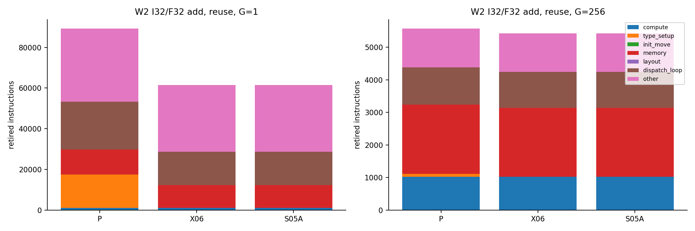
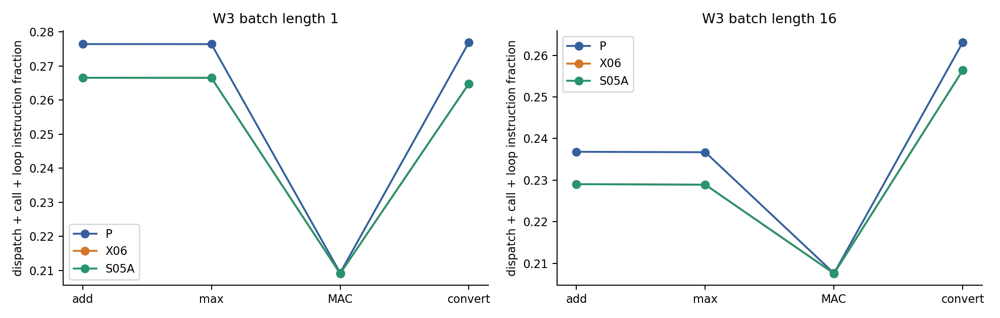
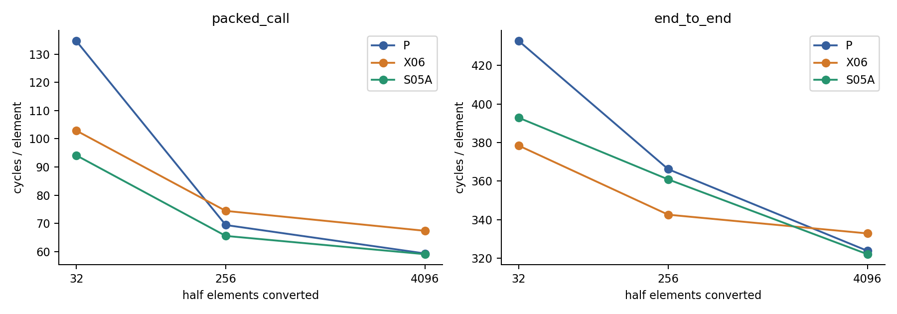

# P、X06、S05A 三组公平对比实验报告（不修改模拟器）

验收状态：**PASS**；检查汇总：`{'PASS': 40}`。已收集主配置记录 3708 条，完整三组配对 1236 个。
另含W1批量 405 条、匹配API 1080 条及独立重复 27 条；合计 5220 条计时记录。专项正确性门槛另计。

## 1. 范围与冻结平台

按用户提供的 v1 方案执行 W1—W5。W6 需要新增模拟指令，按本轮“不修改模拟器”的要求未执行。
模拟器提交为 `26b042f07e3c460037ca151778c0fc3aa2e80f2a`，三组均使用同一个 B11。
B11 SHA256：`6ddf3e8b74544dbe52acad7265fec506f54da96fd9c0c02caf25479ef9355ef9`。
平台为单核 RiscvMinorCPU / 1GHz / 无 I、D cache / DDR3；矩阵 FU opLat=issueLat=16，向量延迟6。
实验新增来宾程序、链接脚本、发码、参考、统计及报告工具；src、example、CPU/FU 和既有测试源码保持冻结内容。

## 2. 工作负载与正确性

| 检查 | 状态 | 实际完成 / 要求 |
|---|---|---|
| P W1-W5 declared population | PASS | 1236 / 1236 |
| P retired/category/compute count closure | PASS | 1236 / — |
| P rdinstret boundary calibration | PASS | 1236 / — |
| P frozen main/control guest ELF identity | PASS | 1236 / — |
| X06 W1-W5 declared population | PASS | 1236 / 1236 |
| X06 retired/category/compute count closure | PASS | 1236 / — |
| X06 rdinstret boundary calibration | PASS | 1236 / — |
| X06 frozen main/control guest ELF identity | PASS | 1236 / — |
| S05A W1-W5 declared population | PASS | 1236 / 1236 |
| S05A retired/category/compute count closure | PASS | 1236 / — |
| S05A rdinstret boundary calibration | PASS | 1236 / — |
| S05A frozen main/control guest ELF identity | PASS | 1236 / — |
| cross-group outputs | PASS | — / — |
| paired logical inputs and useful/padded work agree | PASS | — / — |
| encoding and identical control preparation | PASS | — / — |
| host layout reversibility | PASS | — / — |
| saved ELF/report/config/trace artifact integrity | PASS | — / — |
| MAC coordinates, all half patterns, second target | PASS | — / — |
| M/Acc register boundaries | PASS | — / — |
| callable API linked size and correctness | PASS | — / — |
| matched fixed/runtime API measurements | PASS | — / — |
| short-call batched measurements | PASS | 405 / 405 |
| W1 batch boundary fraction below 1 percent | PASS | — / — |
| matched API full population and trace closure | PASS | 1080 / 1080 |
| final guest compact/full trace equivalence | PASS | — / — |
| logical input and reference archive integrity | PASS | 5193 / 5193 |
| determinism P case 43 | PASS | 3 / — |
| determinism P case 103 | PASS | 3 / — |
| determinism P case 163 | PASS | 3 / — |
| determinism X06 case 43 | PASS | 3 / — |
| determinism X06 case 103 | PASS | 3 / — |
| determinism X06 case 163 | PASS | 3 / — |
| determinism S05A case 43 | PASS | 3 / — |
| determinism S05A case 103 | PASS | 3 / — |
| determinism S05A case 163 | PASS | 3 / — |
| platform full xuantie_v06 | PASS | — / — |
| platform full spec_v05a | PASS | — / — |
| platform frozen old ELF regression | PASS | — / — |
| frozen simulator and integration files unchanged | PASS | — / — |
| no simulator/platform source edits | PASS | — / — |

完整预声明配置为1,236个：W1主集合135（45个任务/R组合×三种ROI/状态）、控制60、W2 30、W3运行时240、固定入口180、W4 GEMM420、组合算子80、W5 60，以及31个校准/门槛配置。
三组在每个配对中使用同一逻辑输入、非零/零 C0、相同有效工作量和独立参考。W3/W4/W5使用固定种子0…9。
MAC专项逐位置验证：每组I8 256、FP16 128、BF16 128个探针；每组全部65,536种半精度扩宽及2,048次第二目标立即消费。
数值主集合使用有界整数/有限二进制数：MAC操作数绝对值不超过3，所有累加中间值小于2²⁴，因此FP32逐k FMA严格精确；参考用任意精度整数计算并断言此界限。加法/转换参考复用独立的精确有理数IEEE标量原语。
主性能数据没有将NaN、Inf、越界转换混入等语义集合；特殊半精度由独立正确性专项覆盖。

## 3. 五维结果

### 3.1 编码空间

| 组别 | 计算规则 | mask包络 | 静态合法字段 |
|---|---:|---:|---:|
| P | 4 | 70,656 | 70,656 |
| X06 | 10 | 146,432 | 146,432 |
| S05A | 10 | 146,432 | 146,400 |

P的运行合法性还依赖描述符。以上只对应本研究计算子集，不代表两份完整原生ISA。

### 3.2 配置复用与动态指令

下图实线为单调用原始ROI，虚线为同样调用在区间内批量重复后的每调用均值。所有冷调用均保留自身配置和数据准备，不对短区间盲减固定周期。

| A1 / R=1 | P周期 | X06周期 | S05A周期 | P退休指令 | X06退休指令 | S05A退休指令 |
|---|---:|---:|---:|---:|---:|---:|
| resident/hot | 1969 | 1888 | 1888 | 35 | 35 | 35 |
| packed_call/cold | 4623 | 3158 | 2969 | 101 | 63 | 62 |
| packed_call/hot | 3603 | 3071 | 2867 | 66 | 63 | 62 |

完整分类计数见 [records.csv](evidence/records.csv)，类别互斥且总和与同一ROI的退休指令数闭合。原始m5统计与rdinstret差值的校准偏移为9条边界指令。

W2每例1024次计算，仅改变同类型批长G，区分复用/专属寄存器。FP16/BF16切换持续使用同一个FP32 Acc。

### 3.3 可调用代码与运行时类型入口

独立编译并链接固定类型API与运行时API，计入实际text及必要rodata；禁用压缩、relaxation，未启用LTO/ICF。P共享计算主体，显式组按类型分派。所有完整类型API均实际运行核对输出。

混合W3采用同类型批次，成组/交替/随机的是批次类型。MAC三类型分别保留逻辑累加器状态，切换I32/FP32时执行真实保存/恢复；不是跨整数位模式和浮点位模式直接共用同一数值。
另有严格匹配输入、各128次冷调用的固定/运行时API配对计时，见 [api-perf-records.json](evidence/api-perf-records.json)。不将固定单类型短调用直接与混合持久状态总Q比较后归因于分派。

### 3.4 完整算子与布局成本

GEMM覆盖三种输入类型、16/32/128方阵、零/非零C0及(13,19,11)尾块，区分已打包调用与从常规行序输入开始的端到端调用。打包与结果整理均由来宾执行。

GEMM内层使用固定类型的手写装载—MAC循环，类型选择在测量入口外完成；W2/W3仅在同类型批次入口分派。GEMM图使用非零C0、十个种子的每有效MAC周期均值；原始零C0、尾块和组合算子数据同样保留在CSV。有效MAC和填充后的实际MAC分别记录。

### 3.5 等量扩宽与软件支持

每32个半精度元素，P/S05A执行一次转换，X06以两个正确重排的输入执行两次转换。不能把这项差异解释为纯类型配置机制差异。

软件支持实证包含原始发码接口、固定/运行时API、共享计算主体、打包规则和正确性维护。当前工具链仍通过.word发出实验指令；没有LLVM后端、硬件面积或功耗实验。W6工程扩展未执行，开发时间/扩展净改动没有虚填。

## 4. 实测数值与分析

W1九种任务、五个R的冷packed_call共45个配对，X06/S05A相对P的原始单调用几何平均加速比分别为1.1818× / 1.1949×。这组包含可摊销的配置/调用成本，不能外推为每条计算指令的固定加速。

同样45个冷调用配对在区间内重复完整调用后，X06/S05A几何平均加速比为1.1950× / 1.2068×；每次冷调用的必要配置、装载和存储仍然执行。

完整GEMM的结果与冷微基准不同。以下按ROI、C0分别给出聚合值；128³的逐类型每MAC成本也单列。无cache下的取指、数据打包和辅助代码影响不能归结为单一类型机制。

下列加速比均为 `P周期 / 显式组周期`：大于1表示显式组较快，小于1表示P较快。每行仅聚合所列同一口径；没有跨工作负载总分。
条件编码：ROI 0=resident、1=packed_call、2=end_to_end；状态0=冷、1=热；W2第二项0=复用寄存器、1=专属寄存器；W3条件为(批长G, 类型序列0成组/1交替/2乱序, 集合)；GEMM条件第二项为C0是否非零。

| 集合 | 条件（ROI/状态/其余参数） | 配对数 | X06几何平均加速比 | S05A几何平均加速比 |
|---|---|---:|---:|---:|
| W1 | (0, 1, 'all-nine-tasks-R1..256') | 45 | 1.0163 | 1.0195 |
| W1 | (1, 0, 'all-nine-tasks-R1..256') | 45 | 1.1818 | 1.1949 |
| W1 | (1, 1, 'all-nine-tasks-R1..256') | 45 | 1.0079 | 1.0247 |
| W1-control | (0, 1, 'six-same-layout-tasks') | 30 | 1.0019 | 1.0094 |
| W1-control | (1, 1, 'six-same-layout-tasks') | 30 | 1.0004 | 1.0033 |
| W2 | (1, 0, 'all-three-type-pairs') | 15 | 1.1339 | 1.1328 |
| W2 | (1, 1, 'all-three-type-pairs') | 15 | 1.0206 | 1.0180 |
| W3-runtime | (1, 0, 'four-families-ten-seeds') | 40 | 1.0405 | 1.0405 |
| W3-runtime | (1, 1, 'four-families-ten-seeds') | 40 | 1.3112 | 1.3112 |
| W3-runtime | (1, 2, 'four-families-ten-seeds') | 40 | 1.1678 | 1.1678 |
| W3-runtime | (16, 0, 'four-families-ten-seeds') | 40 | 1.0183 | 1.0173 |
| W3-runtime | (16, 1, 'four-families-ten-seeds') | 40 | 1.0820 | 1.0817 |
| W3-runtime | (16, 2, 'four-families-ten-seeds') | 40 | 1.0496 | 1.0492 |
| W4-GEMM | (1, 0, 'three-types-all-declared-shapes') | 90 | 1.0015 | 1.0027 |
| W4-GEMM | (1, 1, 'three-types-all-declared-shapes') | 120 | 1.0042 | 1.0043 |
| W4-GEMM | (2, 0, 'three-types-all-declared-shapes') | 90 | 0.9971 | 0.9835 |
| W4-GEMM | (2, 1, 'three-types-all-declared-shapes') | 120 | 0.9940 | 0.9831 |
| W4-pipeline | (1, 'I32-F32-add-I32', 'two-N-ten-seeds') | 20 | 0.9733 | 0.9988 |
| W4-pipeline | (1, 'I32-add-max', 'two-N-ten-seeds') | 20 | 0.9152 | 0.9719 |
| W4-pipeline | (2, 'I32-F32-add-I32', 'two-N-ten-seeds') | 20 | 0.9706 | 0.9962 |
| W4-pipeline | (2, 'I32-add-max', 'two-N-ten-seeds') | 20 | 0.9147 | 0.9730 |
| W5 | (1, 0, 'N32-256-4096-ten-seeds') | 30 | 1.0246 | 1.1501 |
| W5 | (2, 0, 'N32-256-4096-ten-seeds') | 30 | 1.0594 | 1.0397 |

W1短调用的测量边界占比较大，解释配置摊销时同时查看批量结果；上表W1为保留的原始单调用结果。

| 组别 | W1批量记录数 | 批量ROI中最大空区间占比 |
|---|---:|---:|
| P | 135 | 0.4815% |
| X06 | 135 | 0.3570% |
| S05A | 135 | 0.4704% |

### 4.1 动态分类示例

W2 I32/FP32 add、复用寄存器：G=1与256均完成1024次计算，区别是批次切换频率。各列是同一ROI真实退休指令；类别互斥。

| 组别 | G | compute | type_setup | init_move | memory | layout | dispatch_loop | other | 总指令 | 周期 |
|---|---:|---:|---:|---:|---:|---:|---:|---:|---:|---:|
| P | 1 | 1024 | 16406 | 0 | 12333 | 0 | 23575 | 35875 | 89213 | 3011431 |
| P | 256 | 1024 | 86 | 0 | 2133 | 0 | 1135 | 1195 | 5573 | 629825 |
| X06 | 1 | 1024 | 0 | 0 | 11302 | 0 | 16398 | 32800 | 61524 | 2169455 |
| X06 | 256 | 1024 | 0 | 0 | 2122 | 0 | 1098 | 1180 | 5424 | 621982 |
| S05A | 1 | 1024 | 0 | 0 | 11302 | 0 | 16398 | 32800 | 61524 | 2169481 |
| S05A | 256 | 1024 | 0 | 0 | 2122 | 0 | 1098 | 1180 | 5424 | 621982 |

类型配置、分派/循环和普通访存分别列出，避免把总周期差全部解释为类型解析延迟。完整逐例每元素/每MAC工作量及字节计数见CSV。

### 4.2 可调用API的实际代码与分派成本

下表单位为字节。完整集合计入所有固定入口、运行时入口及共享函数一次；单入口列经section GC只保留可达代码。固定入口来自完整类型API对象，保留该编译条件，不冒称全局最短代码。

| 组别 | 类型族 | 类型数 | 完整text | 完整rodata | runtime可达text+rodata | 每种known可达text+rodata | data/bss |
|---|---|---:|---:|---:|---:|---|---|
| P | add | 2 | 168 | 32 | 128 | 80, 80 | 0/0 |
| P | max | 2 | 172 | 32 | 128 | 80, 84 | 0/0 |
| P | MAC | 3 | 272 | 48 | 172 | 108, 112, 108 | 0/0 |
| P | convert | 2 | 164 | 32 | 124 | 72, 72 | 0/0 |
| X06 | add | 2 | 128 | 0 | 128 | 32, 32 | 0/0 |
| X06 | max | 2 | 128 | 0 | 128 | 32, 32 | 0/0 |
| X06 | MAC | 3 | 288 | 0 | 288 | 60, 60, 60 | 0/0 |
| X06 | convert | 2 | 112 | 0 | 112 | 28, 28 | 0/0 |
| S05A | add | 2 | 128 | 0 | 128 | 32, 32 | 0/0 |
| S05A | max | 2 | 128 | 0 | 128 | 32, 32 | 0/0 |
| S05A | MAC | 3 | 288 | 0 | 288 | 60, 60, 60 | 0/0 |
| S05A | convert | 2 | 112 | 0 | 112 | 28, 28 | 0/0 |

下表是同一逻辑输入和128次独立冷调用下，运行时入口减固定入口的每调用均值。每行覆盖该类型族所有类型与10个种子；R表示每次调用计算次数。

| 组别 | 类型族 | R | 配对数 | 额外周期/调用 | 额外指令/调用 |
|---|---|---:|---:|---:|---:|
| P | add | 1 | 20 | 100.984 | 4.000 |
| P | add | 16 | 20 | 104.905 | 4.000 |
| P | max | 1 | 20 | 100.165 | 3.500 |
| P | max | 16 | 20 | 105.490 | 3.500 |
| P | MAC | 1 | 30 | 42.442 | 3.667 |
| P | MAC | 16 | 30 | 37.814 | 3.667 |
| P | convert | 1 | 20 | 103.791 | 5.000 |
| P | convert | 16 | 20 | 102.630 | 5.000 |
| X06 | add | 1 | 20 | 135.712 | 9.500 |
| X06 | add | 16 | 20 | 134.438 | 9.500 |
| X06 | max | 1 | 20 | 135.542 | 9.500 |
| X06 | max | 16 | 20 | 134.831 | 9.500 |
| X06 | MAC | 1 | 30 | 236.769 | 11.667 |
| X06 | MAC | 16 | 30 | 247.440 | 11.667 |
| X06 | convert | 1 | 20 | 161.518 | 8.500 |
| X06 | convert | 16 | 20 | 160.644 | 8.500 |
| S05A | add | 1 | 20 | 135.470 | 9.500 |
| S05A | add | 16 | 20 | 134.546 | 9.500 |
| S05A | max | 1 | 20 | 135.196 | 9.500 |
| S05A | max | 16 | 20 | 134.514 | 9.500 |
| S05A | MAC | 1 | 30 | 236.983 | 11.667 |
| S05A | MAC | 16 | 30 | 245.136 | 11.667 |
| S05A | convert | 1 | 20 | 161.368 | 8.500 |
| S05A | convert | 16 | 20 | 161.511 | 8.500 |

代码大小与周期回答不同问题：P的可共享主体仍需要描述符常量和调用，显式类型族可通过一次分派进入整批内核。差值同时包含分派、调用和无cache代码组织成本，不能推广成所有编译器的必然开销。

### 4.3 完整算子与扩宽的具体结果

下表GEMM取128³、非零C0，所有10个种子的每有效MAC周期均值；端到端包含来宾打包和整理。

| 任务 | ROI | P周期/MAC | X06周期/MAC | S05A周期/MAC |
|---|---|---:|---:|---:|
| G1 | packed_call | 3.31244 | 3.32648 | 3.32598 |
| G1 | end_to_end | 14.45654 | 14.57582 | 14.67946 |
| G2 | packed_call | 5.41254 | 5.43223 | 5.42861 |
| G2 | end_to_end | 19.16383 | 19.18401 | 19.49411 |
| G3 | packed_call | 5.41353 | 5.40000 | 5.40031 |
| G3 | end_to_end | 19.16452 | 19.15199 | 19.46535 |

W5取N=4096，周期/元素为10种子的均值。访存字节是架构请求量，含重复整寄存器访问，与准备后缓冲区跨度不同。

| 组别 | ROI | 计算指令 | 峰值M | 矩阵读B | 矩阵写B | 周期/元素 |
|---|---|---:|---:|---:|---:|---:|
| P | packed_call | 128 | 3 | 8192 | 16384 | 59.3377 |
| P | end_to_end | 128 | 3 | 8192 | 16384 | 323.8215 |
| X06 | packed_call | 256 | 4 | 16384 | 16384 | 67.3782 |
| X06 | end_to_end | 256 | 4 | 16384 | 16384 | 332.8617 |
| S05A | packed_call | 128 | 3 | 8192 | 16384 | 59.0851 |
| S05A | end_to_end | 128 | 3 | 8192 | 16384 | 322.0769 |

### 4.4 编译后的主实验镜像清单

以下统计实际section字节，公共启动/运行时单列。kernels包含W2—W5各入口，types/moves/layout为共享支持代码；rodata还包含完整配置表。这是整个实验镜像清单，不把全部配置表或不可达函数计作单个算子的最小代码。

| 组别 | compute | types | moves | layout | W1合计 | kernels | 启动/测量/运行时 | rodata | data | bss | input/output/scratch保留 |
|---|---:|---:|---:|---:|---:|---:|---:|---:|---:|---:|---|
| P | 2184 | 192 | 108 | 2612 | 1680 | 5592 | 60512 | 74984 | 48 | 23040 | 786432/1048576/2097152 |
| X06 | 5256 | 44 | 128 | 2680 | 1444 | 5432 | 60472 | 74944 | 48 | 23040 | 786432/1048576/2097152 |
| S05A | 5256 | 44 | 108 | 2840 | 1444 | 5436 | 60472 | 74944 | 48 | 23040 | 786432/1048576/2097152 |

### 4.5 软件支持与工程记录

| 层次 | 本轮实际工作 | 可追溯证据 / 未测范围 |
|---|---|---|
| 发码 | P保留现有类型指令；X06/S05A读取各自encoding.csv生成32位计算字 | build.py、每次运行的ops.S和反汇编；未实现LLVM/GCC新后端 |
| 类型管理 | P通过Md/Ad配置并共享合法主体；显式组仅保留搬运/Acc所需配置 | bench.c、API源代码与真实type_setup计数 |
| 布局 | P按4×4块、X06按A/BT行、S05A按A/B行打包；X06扩宽重排两份输入 | 来宾pack函数、逐坐标门槛、全部半精度位模式门槛 |
| 运行时接口 | 相同type_id/指针、批级分派；另作固定/运行时同输入冷调用配对 | API链接大小、1080条计时、540个固定/运行时配对 |
| 正确性维护 | 每组实际数值/flags/trap/饱和检查、跨组三方输出比对及原平台回归 | acceptance.json及原始records；异常语义差异不混入主性能样本 |
| 模拟器扩展 | 本轮src/example/tests/build_opts净改动为零 | 冻结哈希与git差异检查；X06/S05A既有独立执行实现保持原状 |
| W6 BF16扩宽 | 按本轮范围未执行 | 无新增规则/扩展代码/开发工时数据；不虚填复杂度等级或开发时间 |

本轮代码包含工具生成的内核与公共模板，未记录可比较的人工主动开发计时，因此不能据此给三种ISA的开发时间排序。

## 5. 测量方法与结果边界

- 测量入口固定在0x80010000，计算/类型/搬运/布局/W1函数分区放置；输入、输出、scratch分别固定于0x81000000、0x81800000、0x82000000。
- 每ROI以m5 reset/dump建立边界，结束前fence；保留标记自身指令。结果存储以该模型的fence和已提交指令为可见性边界，不宣称DRAM单元已经完成物理写入。
- 主运行在同一进程内按相同配置顺序测多个独立、不嵌套ROI。m5 reset只清统计，不重置DDR控制器/前端历史；独立启动的单用例示例与主运行同一用例可以有不同周期，但指令数和结果应一致。27次独立重复验证的是相同启动条件的确定性，不是不同前序历史的等价性。
- 正确性生成、参考答案、结果比较和semihosting均在ROI外。1024 NOP等待也在ROI外。
- Exec在当前Minor实现的提交处输出；按PC、机器字和调用上下文分类，检查真实计算条数及64B整寄存器访存。matrix_load/store_bytes不冒充总线流量，标量layout/stack访问另计。
- 空ROI、单次和长批次分别记录。短调用保留原始结果和区间内重复结果；统计不人为制造置信区间。种子均值反映输入差异。
- 主实验使用当前实现的合法软件序列和公共调用约定；公共循环/可调用辅助函数本身属于实测成本，不宣称每一序列达到理论全局最短指令数。控制实验的六种任务经静态审计确认外围机器码和地址相同，仅计算机器字不同。
- 初始类型冷/热与cache无关。无cache、固定矩阵FU和串行化会影响取指、重定向与访存周期。相同计算条数下的剩余差异不能全部归因于描述符读取。
- 主结果衡量当前研究实现的任务成本，不推出完整原生Xuantie/spec优劣，也不把C++宿主执行速度当作目标周期。

## 6. 原始证据与复现

见 [README](../../experiments/ame_compare_v1/README.md) 和冻结的 [PLAN_v1.md](../../experiments/ame_compare_v1/PLAN_v1.md)。
README提供独立启动的A1冷调用命令：`--start 32 --end 33 --trace --tag demo-A1-cold`。来宾入口为bench.c中的w1_0，计算循环由build.py生成repeat_0_0；完整调用包含配置、装载、计算和存储。本次额外复现结果为{'S05A': {'status': 'PASS', 'retired': 62, 'compute': 1}, 'X06': {'status': 'PASS', 'retired': 63, 'compute': 1}, 'P': {'status': 'PASS', 'retired': 101, 'compute': 1}}，详见 [示例记录](evidence/demo-A1-cold.json)。此示例不混入主计时汇总。
结果CSV与紧凑JSON见 [evidence](evidence/acceptance.json)；原始ELF、输入生成配置、链接map、指令trace、stats、命令和失败记录保留在 results/ame_compare_v1。
SHA256及源码来源见 [manifest.json](evidence/manifest.json)。所有未完成项目显示NOT_RUN，不以既有功能测试PASS替代本次性能验收。

开发期先采集了通用内层分派版本，发现其逐MAC分派不符合方案后中止，保留为provisional数据；正式报告只采用formal标签、已移除内层分派的程序。另曾修正trace分类器：P的R2族共享funct7，必须同时检查rs2子功能，避免将类型配置当作转换计算。原始数值输出没有变化，旧解析结果和trace保留，最终采用修正后的重新解析记录。
