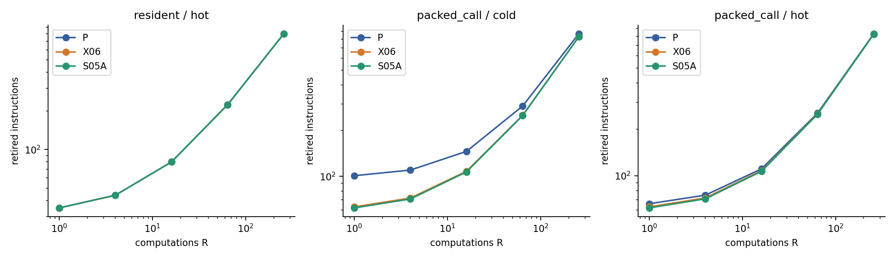
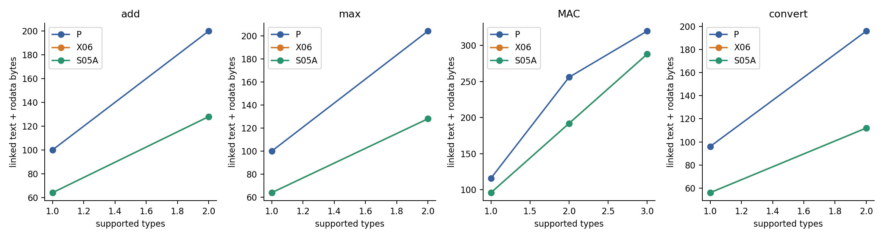
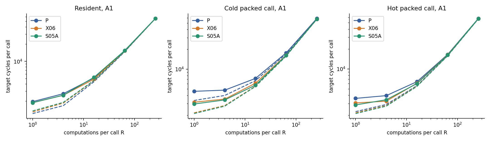
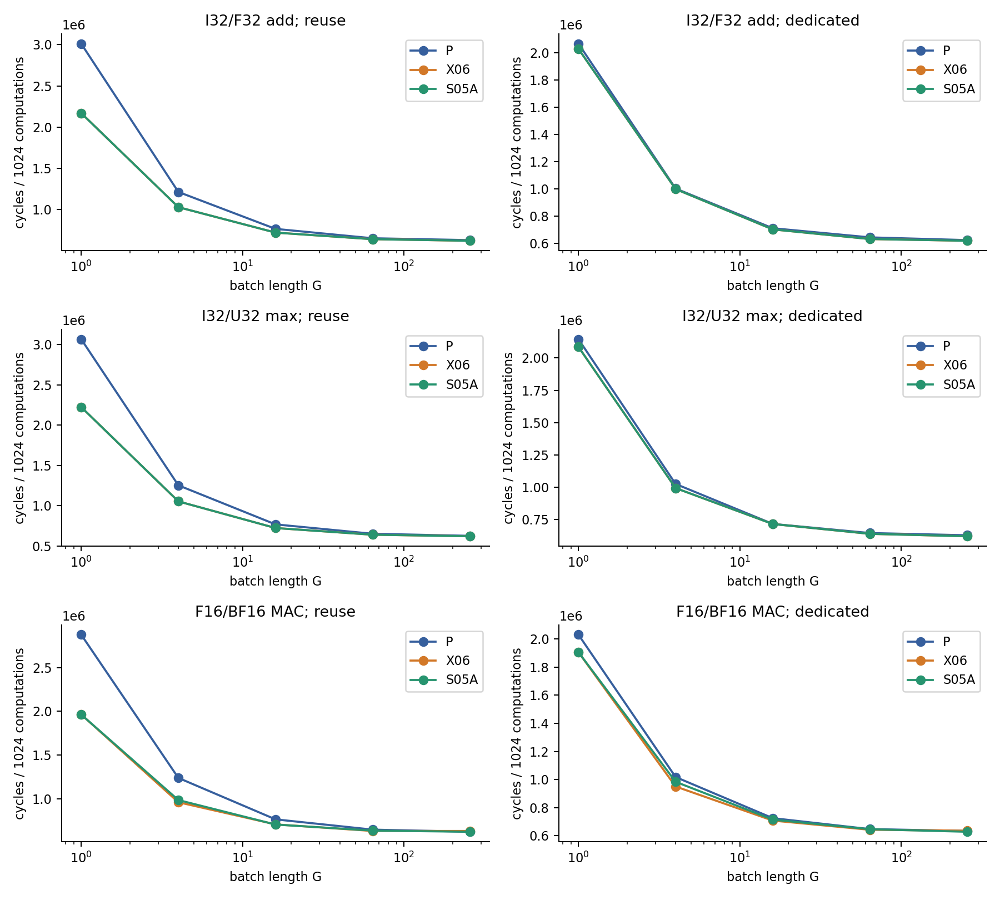
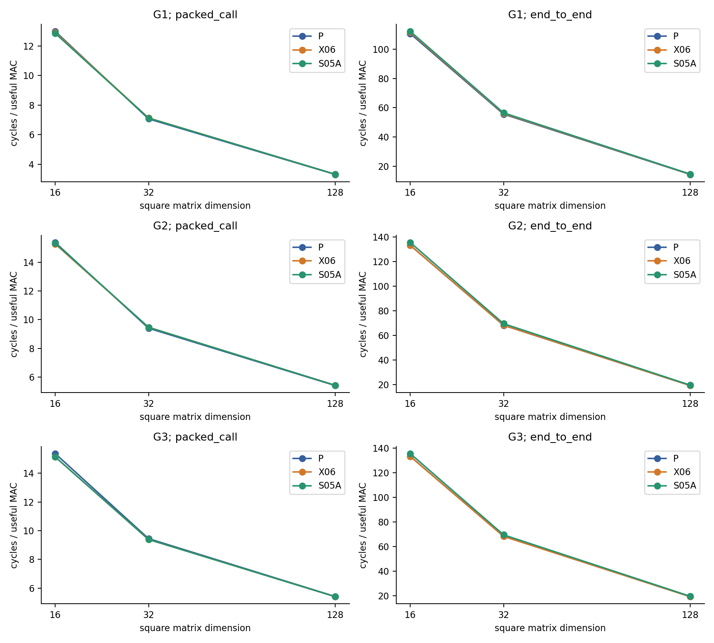

# P、X06、S05A 三组公平对比实验报告（不修改模拟器）

验收状态：**PASS**；检查汇总：`{'PASS': 40}`。已收集主配置记录 3708 条，完整三组配对 1236 个。
另含W1批量 405 条、匹配API 1080 条及独立重复 27 条；合计 5220 条计时记录。专项正确性门槛另计。

## 1. 范围与冻结平台

按用户提供的 v1 方案执行 W1—W5。W6 需要新增模拟指令，按本轮“不修改模拟器”的要求未执行。
模拟器提交为 `26b042f07e3c460037ca151778c0fc3aa2e80f2a`，三组均使用同一个 B11。
B11 SHA256：`6ddf3e8b74544dbe52acad7265fec506f54da96fd9c0c02caf25479ef9355ef9`。
平台为单核 RiscvMinorCPU / 1GHz / 无 I、D cache / DDR3；矩阵 FU opLat=issueLat=16，向量延迟6。
实验新增来宾程序、链接脚本、发码、参考、统计及报告工具；src、example、CPU/FU 和既有测试源码保持冻结内容。

## 2. 工作负载与正确性

表中“实际结果”列从已有记录提取数量或观测值，“验收要求”列说明通过条件。记录数、三组配对数、执行次数和文件数使用不同单位，不相加作为新的用例总数。条件检查直接列条件；没有数据时应写未取得记录，不能以横线代替。

| 检查 | 状态 | 实际结果 | 验收要求 |
|---|---|---|---|
| P W1—W5预声明配置 | PASS | 1236 条记录；非PASS 0 条 | 每组1,236条记录齐全，数值/标志/trap/计数检查均通过 |
| P 退休/分类/计算计数闭合 | PASS | 1236 条；不闭合 0 条 | 每组1,236条；分类计数之和=退休数，计算条数符合预期，无未知PC |
| P rdinstret边界校准 | PASS | 1236 条；观测差值集合 [9] | 每组1,236条，退休数−rdinstret差值均为9条 |
| P 主/控制程序ELF身份 | PASS | 1236 条；ELF哈希不匹配 0 条 | 每组1,236条记录的ELF哈希均匹配相应冻结主/控制构建 |
| X06 W1—W5预声明配置 | PASS | 1236 条记录；非PASS 0 条 | 每组1,236条记录齐全，数值/标志/trap/计数检查均通过 |
| X06 退休/分类/计算计数闭合 | PASS | 1236 条；不闭合 0 条 | 每组1,236条；分类计数之和=退休数，计算条数符合预期，无未知PC |
| X06 rdinstret边界校准 | PASS | 1236 条；观测差值集合 [9] | 每组1,236条，退休数−rdinstret差值均为9条 |
| X06 主/控制程序ELF身份 | PASS | 1236 条；ELF哈希不匹配 0 条 | 每组1,236条记录的ELF哈希均匹配相应冻结主/控制构建 |
| S05A W1—W5预声明配置 | PASS | 1236 条记录；非PASS 0 条 | 每组1,236条记录齐全，数值/标志/trap/计数检查均通过 |
| S05A 退休/分类/计算计数闭合 | PASS | 1236 条；不闭合 0 条 | 每组1,236条；分类计数之和=退休数，计算条数符合预期，无未知PC |
| S05A rdinstret边界校准 | PASS | 1236 条；观测差值集合 [9] | 每组1,236条，退休数−rdinstret差值均为9条 |
| S05A 主/控制程序ELF身份 | PASS | 1236 条；ELF哈希不匹配 0 条 | 每组1,236条记录的ELF哈希均匹配相应冻结主/控制构建 |
| 三组输出一致性 | PASS | 1236 个配对，输出不一致 0 个 | 1,236个配对均输出一致 |
| 三组输入及有效/填充工作量 | PASS | 1236 个配对；不一致 0 个 | 1,236个配对的逻辑输入、有效及填充工作量一致 |
| 编码与同准备控制审计 | PASS | 3/3 组编码审计；10/10 个外围函数通过 | 3组编码规则通过核算；10个外围函数的机器码和地址在三组间一致 |
| 宿主打包/解包可逆性 | PASS | 12/12 项通过；MAC坐标 384 个，C3元素 96 个 | 12项均通过：三组×3种MAC布局及C3；合计384个坐标、96个C3元素 |
| 运行产物完整性 | PASS | 81/81 个目录通过，关联 5220 条计时记录 | 81个目录的必需文件齐全，ELF/报告/配置哈希符合各自清单；关联5,220条计时记录 |
| MAC坐标、半精度全集及第二目标 | PASS | P：MAC探针512、半精度位模式65536、第二目标消费2048、失败0；X06：MAC探针512、半精度位模式65536、第二目标消费2048、失败0；S05A：MAC探针512、半精度位模式65536、第二目标消费2048、失败0 | 每组512个MAC探针、65,536种半精度位模式、2,048次第二目标消费；数值与标志符合参考 |
| M/Acc寄存器边界 | PASS | P：4/4 项通过；X06：4/4 项通过；S05A：4/4 项通过 | 每组4项均符合对应契约：M30/M31转换、Acc3合法、Acc4非法；X06单目标允许M31 |
| 可调用API代码大小与正确性 | PASS | 27 组链接大小；108 次输出核对；失败API 0 | 27组类型增长链接记录齐全；完整类型API共108次输出核对均通过 |
| 固定/运行时API配对计时 | PASS | 1080 条记录，汇总状态PASS | 1,080条计时记录，数值、标志及轨迹检查均通过 |
| 短调用批量测量 | PASS | 405/405 条记录 | 405条均通过数值及轨迹核验 |
| W1批量测量边界占比 | PASS | P最大0.4815%；X06最大0.3570%；S05A最大0.4704% | 405条批量记录中，每条空ROI周期/批量ROI周期均小于1% |
| 匹配API完整集合与计数闭合 | PASS | 1080/1080 条记录 | 1,080条唯一配置记录，数值及最终trace计数均通过 |
| 最终ELF两种trace格式等价性 | PASS | mini：101条、4459周期；text：101条、4459周期；输出哈希种类1 | 同一最终ELF下两格式的simInsts、simOps、ticks、周期与输出哈希一致 |
| 逻辑输入与参考归档 | PASS | 5193/5193 条索引记录 | 5,193条索引；所指输入文件和参考文件均存在且哈希一致 |
| P 用例43独立重复 | PASS | 3 次；(周期、指令数、输出哈希)组合数 1 | 3次全新启动；周期、退休指令数和输出哈希完全一致 |
| P 用例103独立重复 | PASS | 3 次；(周期、指令数、输出哈希)组合数 1 | 3次全新启动；周期、退休指令数和输出哈希完全一致 |
| P 用例163独立重复 | PASS | 3 次；(周期、指令数、输出哈希)组合数 1 | 3次全新启动；周期、退休指令数和输出哈希完全一致 |
| X06 用例43独立重复 | PASS | 3 次；(周期、指令数、输出哈希)组合数 1 | 3次全新启动；周期、退休指令数和输出哈希完全一致 |
| X06 用例103独立重复 | PASS | 3 次；(周期、指令数、输出哈希)组合数 1 | 3次全新启动；周期、退休指令数和输出哈希完全一致 |
| X06 用例163独立重复 | PASS | 3 次；(周期、指令数、输出哈希)组合数 1 | 3次全新启动；周期、退休指令数和输出哈希完全一致 |
| S05A 用例43独立重复 | PASS | 3 次；(周期、指令数、输出哈希)组合数 1 | 3次全新启动；周期、退休指令数和输出哈希完全一致 |
| S05A 用例103独立重复 | PASS | 3 次；(周期、指令数、输出哈希)组合数 1 | 3次全新启动；周期、退休指令数和输出哈希完全一致 |
| S05A 用例163独立重复 | PASS | 3 次；(周期、指令数、输出哈希)组合数 1 | 3次全新启动；周期、退休指令数和输出哈希完全一致 |
| 原平台 xuantie_v06 全量功能回归 | PASS | 14359 个用例、28718 次执行；失败0 | 完整suite、无limit截断、random_per_seed=100；失败0 |
| 原平台 spec_v05a 全量功能回归 | PASS | 12311 个用例、24622 次执行；失败0 | 完整suite、无limit截断、random_per_seed=100；失败0 |
| 原平台冻结ELF回归 | PASS | 65 条回归记录，汇总状态PASS | 13个冻结ELF×5个配置=65条，均通过原回归判据 |
| 冻结模拟器与集成文件哈希 | PASS | 11/11 个文件哈希一致 | 冻结清单中所有文件SHA256一致，包含同一B11二进制 |
| 模拟器/平台/既有测试源码改动 | PASS | 相对冻结提交的改动文件数：0 | src、example、build_opts、tests下相对冻结提交的改动文件数为0 |

完整预声明配置为1,236个：W1主集合135（45个任务/R组合×三种ROI/状态）、控制60、W2 30、W3运行时240、固定入口180、W4 GEMM420、组合算子80、W5 60，以及31个校准/门槛配置。
三组在每个配对中使用同一逻辑输入、非零/零 C0、相同有效工作量和独立参考。W3/W4/W5使用固定种子0…9。
MAC专项逐位置验证：每组I8 256、FP16 128、BF16 128个探针；每组全部65,536种半精度扩宽及2,048次第二目标立即消费。
数值主集合使用有界整数/有限二进制数：MAC操作数绝对值不超过3，所有累加中间值小于2²⁴，因此FP32逐k FMA严格精确；参考用任意精度整数计算并断言此界限。加法/转换参考复用独立的精确有理数IEEE标量原语。
主性能数据没有将NaN、Inf、越界转换混入等语义集合；特殊半精度由独立正确性专项覆盖。

## 3. 按D1—D5组织实验结果

D1—D5是评价维度，W1—W5是工作负载；二者不一一对应。同一个W实验可以同时产生指令数、代码大小和周期数据，但这些指标回答不同问题。正确性PASS和测量校准是各维度结果的使用门槛，不是性能优势。

| 评价维度 | 要回答的问题 | 对应实验与指标 | 本报告中的结果及原始证据 |
|---|---|---|---|
| D1 编码空间 | 表达相同类型任务占用多少译码规则和机器字？ | 十种任务静态核算；4→7→10类型增长 | §3.1；static-audit.json、encoding-growth.json |
| D2 动态指令开销 | 完成同一任务执行多少条指令，额外指令花在哪里？ | W1总退休指令；W2分类计数；W3分派/调用/循环占比；W5等量计算条数 | §3.2、§4.1；records.csv中的retired_insts、insts_*，paired.csv中的instruction_reduction |
| D3 静态代码大小 | 提供同样可调用功能需要多少机器代码和常量？ | W3固定/运行时API及支持类型增长；主镜像section清单 | §3.3、§4.2代码表、§4.4；api-summary.json、image-size.json |
| D4 执行性能 | 完成同一任务需要多少目标周期，有效吞吐多少？ | W1配置复用；W2类型切换；W3匹配API计时；W4完整算子；W5等量扩宽 | §3.4、§4聚合表、§4.2计时表、§4.3；records.csv、paired.csv、api-paired.json、boundary-fractions.json |
| D5 软件支持与扩展性 | 来宾需要哪些配置、分派和布局支持？扩展类型需要哪些工程改动？ | W3可调用接口与共享主体、W4/W5布局及正确性维护；W6本轮未做 | §3.5、§4.5工程记录；来宾/API源代码及门槛记录。只有软件支持部分证据，未完成新增类型工程实验 |

| 工作负载 | 本轮实际改变的因素 | 产生结果的维度 |
|---|---|---|
| W1 固定类型与配置复用 | R=1/4/16/64/256；resident热、已打包冷/热；另有六任务同准备控制 | D2指令数、D4周期 |
| W2 类型切换 | 总计算Q=1024不变，改变批长G和寄存器复用策略 | D2分类指令、D4周期 |
| W3 固定/运行时类型API | 类型族、批长、类型序列、固定/运行时入口、支持类型数 | D2分派开销、D3代码大小、D4周期、D5软件接口 |
| W4 GEMM与组合算子 | 类型、形状、C0、尾块、已打包/端到端 | D4主结果；D2计数和字节量用于解释，D5布局支持 |
| W5 FP16扩宽 | 相同有效元素N=32/256/4096；已打包/端到端 | D2计算条数与流量、D4周期、D5布局适配 |
| W6 BF16扩宽工程扩展 | 需要修改模拟器，本轮未执行 | D5扩展性证据缺项，不记为PASS |

以下各图的P/X06/S05A均是三组实现；图中多个子图是条件或指标切片，不代表新增了不同的评价维度。

### 3.1 D1：编码空间

该维度来自静态编码核算，不使用运行周期。十种共同逻辑任务的结果如下。

| 组别 | 计算规则 | mask包络 | 静态合法字段 |
|---|---:|---:|---:|
| P | 4 | 70,656 | 70,656 |
| X06 | 10 | 146,432 | 146,432 |
| S05A | 10 | 146,432 | 146,400 |

P用4条计算规则覆盖本轮十种类型任务，X06/S05A各用10条。P的运行合法性还依赖描述符；S05A全量扩宽排除rd=31。该结果只描述本研究子集，不是完整原生ISA的空间占用，也不是程序代码大小。
支持类型按固定顺序从4→7→10增长的规则数和机器字数见 [encoding-growth.json](evidence/encoding-growth.json)。

### 3.2 D2：动态指令开销

退休指令是处理器最终提交的架构指令。此处纵轴统计整个ROI内的计算、配置、搬运、访存、分派/循环和测量边界指令；它既不是计算指令条数，也不是源代码行数。其用途是判断“是否为了同一任务多执行了指令”，再用分类计数定位额外成本。指令数不等于周期，运行快慢在D4单独报告。

**图D2-1：W1 A1（16元素I32加法）的总退休指令数随R变化。** 横轴R为一次调用内计算次数，纵轴为该调用ROI的退休指令总数；三种测量条件分别绘图。

| 条件 | 初始状态与测量范围 | 对照目的 |
|---|---|---|
| resident/hot | 类型和输入已在寄存器中；计入计算、循环和边界 | 观察移出初始配置/装载后，计算与控制序列的指令量 |
| packed_call/cold | 输入已打包在内存；计入配置、装载、计算、存储和调用 | 观察一次完整冷调用的指令成本 |
| packed_call/hot | 类型已匹配，输入已打包在内存；仍计入装载、计算、存储和调用 | 观察复用类型后还需要多少指令 |

三种条件用于区分配置复用、寄存器驻留和完整调用的影响；冷/热指软件类型状态，与cache无关。
左图三条线完全重合，绿色最后绘制覆盖另外两条。A1在resident/hot下三组均为I(R)=3R+32：R条计算、2R条循环控制以及32条其余固定指令。中图冷调用P需要更多指令，右图复用类型后差距缩小。该结论限于此处A1及当前软件序列；九任务完整结果见CSV。

| A1、R=1 | P退休指令 | X06退休指令 | S05A退休指令 |
|---|---:|---:|---:|
| resident/hot | 35 | 35 | 35 |
| packed_call/cold | 101 | 63 | 62 |
| packed_call/hot | 66 | 63 | 62 |

**图D2-2：W2 I32/FP32 add的指令分类。** 固定1024次计算和复用寄存器策略，比较G=1与256；柱内区分compute、type_setup、init_move、memory、layout、dispatch_loop、other。它回答类型切换频率改变时，增加的是哪类指令。对应数值表见§4.1。

**图D2-3：W3运行时多类型入口的分派/调用/循环指令占比。** 两个子图对应批长1和16，各点是相应类型族所有序列与种子的占比均值。dispatch_loop包含调用、返回及循环，不是纯类型分派；占比降低也不自动等于总周期同比降低。

W5另提供等量扩宽的计算条数：每32个FP16元素P/S05A各1条、X06为2条，见§4.3。分类总和与同一ROI的总退休计数闭合；类型隐式读取不另计一条架构指令。逐例计数、每元素/每MAC计数及指令减少率见 [records.csv](evidence/records.csv) 和 [paired.csv](evidence/paired.csv)。

### 3.3 D3：静态代码大小

**图D3-1：W3可调用API的代码大小随支持类型数增长。** 横轴是该类型族支持的类型数，纵轴为编译链接后的text+必要rodata字节；完整集合包含固定入口、运行时入口及可达支持主体，共享函数只计一次。它衡量提供接口需要多少程序字节，与D1的ISA编码空间、D2的运行次数不同。

§4.2给出完整API与section GC后的单入口text/rodata表；§4.4给出主实验镜像section清单，启动/测量/运行时与内核分列。三组均禁用压缩、relaxation、LTO/ICF。实际大小来自 [api-summary.json](evidence/api-summary.json) 和 [image-size.json](evidence/image-size.json)。
结果没有“P所有API都更小”的统一结论：完整MAC API的P为320B、显式组为288B，而仅保留运行时可达入口时P为172B、显式组为288B；必须同时说明保留哪些入口。

### 3.4 D4：执行性能

本维度使用目标周期、每有效元素/MAC周期和配对加速比P周期/显式组周期。宿主运行时长和退休指令数都不能代替这些指标。§4按同一ROI/状态分别聚合，不生成跨任务总冠军分数。

**图D4-1：W1 A1的配置复用与周期。** 横轴R与图D2-1相同，但纵轴改为每调用目标周期。实线为单调用原始ROI，虚线为区间内重复完整调用后的每调用均值；冷调用每次都保留配置、装载和初始化。三子图的测量范围同D2-1。它与D2-1配合判断：周期差是否伴随额外指令；同指令数的剩余差异需考虑依赖、无cache取指和访存历史。

**图D4-2：W2类型切换周期。** 每例完成1024次计算，横轴为同类型批长G，纵轴为整个任务周期；六个子图为三种类型对×两种寄存器策略。与D2-2的分类计数共同解释频繁切换的成本。FP16/BF16切换持续使用同一个FP32 Acc。

**W3匹配API计时表（§4.2）**：相同输入、各128次独立冷调用，对比固定/运行时入口，报告额外周期/调用；同表额外指令/调用归D2。混合序列W3-runtime的配对加速比见§4聚合表。MAC三类型保留各自逻辑累加器，不能将整数/浮点位模式直接视为同一个数值。

**图D4-3：W4 GEMM每有效MAC周期。** 三种类型×已打包/端到端构成六个子图，取非零C0、16/32/128方阵和十个种子的均值。GEMM类型选择在ROI外，内层为固定类型装载—MAC循环。零C0、尾块(13,19,11)、两种组合算子的结果同样保留在CSV和§4聚合表。端到端计入来宾打包和结果整理。

**图D4-4：W5等量FP16扩宽的每元素周期。** 横轴N=32/256/4096，两个子图区分已打包/端到端；各组均输出N个FP32。X06必须重排两份输入、每32元素执行两条转换；P/S05A各执行一条，故该结果包含当前原语能力和布局差异，不能全部归因于类型配置机制。

逐例cycles、cycles_per_element、cycles_per_MAC、有效吞吐见records.csv；配对加速比见paired.csv；匹配API差值见 [api-paired.json](evidence/api-paired.json)。短区间边界占比见 [boundary-fractions.json](evidence/boundary-fractions.json)，W1长批次最大值三组均低于1%。

### 3.5 D5：软件支持与扩展性（本轮部分覆盖）

本轮软件支持证据包括W3固定/运行时API、配置表与共享主体、各组独立发码接口，以及W4/W5布局和正确性维护。详见§4.5工程记录表；API源代码与来宾pack函数是实际可审查产物。D3代码大小和D4运行成本帮助量化这些接口的成本，但不能单独证明完整工具生态更成熟。
目前工具链通过.word发出研究指令，未实现完整LLVM/GCC后端。W6新增BF16→FP32转换需要修改模拟器，按本轮要求未执行；因此新增类型的译码/执行净改动、开发工时、修复次数均无本轮实测结果。D5的新增类型扩展性部分保持未验证，不从既有API推导普遍工程复杂度排名。

## 4. 实测数值与分析

W1九种任务、五个R的冷packed_call共45个配对，X06/S05A相对P的原始单调用几何平均加速比分别为1.1818× / 1.1949×。这组包含可摊销的配置/调用成本，不能外推为每条计算指令的固定加速。

同样45个冷调用配对在区间内重复完整调用后，X06/S05A几何平均加速比为1.1950× / 1.2068×；每次冷调用的必要配置、装载和存储仍然执行。

完整GEMM的结果与冷微基准不同。以下按ROI、C0分别给出聚合值；128³的逐类型每MAC成本也单列。无cache下的取指、数据打包和辅助代码影响不能归结为单一类型机制。

下列加速比均为 `P周期 / 显式组周期`：大于1表示显式组较快，小于1表示P较快。每行仅聚合所列同一口径；没有跨工作负载总分。
条件编码：ROI 0=resident、1=packed_call、2=end_to_end；状态0=冷、1=热；W2第二项0=复用寄存器、1=专属寄存器；W3条件为(批长G, 类型序列0成组/1交替/2乱序, 集合)；GEMM条件第二项为C0是否非零。

| 集合 | 条件（ROI/状态/其余参数） | 配对数 | X06几何平均加速比 | S05A几何平均加速比 |
|---|---|---:|---:|---:|
| W1 | (0, 1, 'all-nine-tasks-R1..256') | 45 | 1.0163 | 1.0195 |
| W1 | (1, 0, 'all-nine-tasks-R1..256') | 45 | 1.1818 | 1.1949 |
| W1 | (1, 1, 'all-nine-tasks-R1..256') | 45 | 1.0079 | 1.0247 |
| W1-control | (0, 1, 'six-same-layout-tasks') | 30 | 1.0019 | 1.0094 |
| W1-control | (1, 1, 'six-same-layout-tasks') | 30 | 1.0004 | 1.0033 |
| W2 | (1, 0, 'all-three-type-pairs') | 15 | 1.1339 | 1.1328 |
| W2 | (1, 1, 'all-three-type-pairs') | 15 | 1.0206 | 1.0180 |
| W3-runtime | (1, 0, 'four-families-ten-seeds') | 40 | 1.0405 | 1.0405 |
| W3-runtime | (1, 1, 'four-families-ten-seeds') | 40 | 1.3112 | 1.3112 |
| W3-runtime | (1, 2, 'four-families-ten-seeds') | 40 | 1.1678 | 1.1678 |
| W3-runtime | (16, 0, 'four-families-ten-seeds') | 40 | 1.0183 | 1.0173 |
| W3-runtime | (16, 1, 'four-families-ten-seeds') | 40 | 1.0820 | 1.0817 |
| W3-runtime | (16, 2, 'four-families-ten-seeds') | 40 | 1.0496 | 1.0492 |
| W4-GEMM | (1, 0, 'three-types-all-declared-shapes') | 90 | 1.0015 | 1.0027 |
| W4-GEMM | (1, 1, 'three-types-all-declared-shapes') | 120 | 1.0042 | 1.0043 |
| W4-GEMM | (2, 0, 'three-types-all-declared-shapes') | 90 | 0.9971 | 0.9835 |
| W4-GEMM | (2, 1, 'three-types-all-declared-shapes') | 120 | 0.9940 | 0.9831 |
| W4-pipeline | (1, 'I32-F32-add-I32', 'two-N-ten-seeds') | 20 | 0.9733 | 0.9988 |
| W4-pipeline | (1, 'I32-add-max', 'two-N-ten-seeds') | 20 | 0.9152 | 0.9719 |
| W4-pipeline | (2, 'I32-F32-add-I32', 'two-N-ten-seeds') | 20 | 0.9706 | 0.9962 |
| W4-pipeline | (2, 'I32-add-max', 'two-N-ten-seeds') | 20 | 0.9147 | 0.9730 |
| W5 | (1, 0, 'N32-256-4096-ten-seeds') | 30 | 1.0246 | 1.1501 |
| W5 | (2, 0, 'N32-256-4096-ten-seeds') | 30 | 1.0594 | 1.0397 |

W1短调用的测量边界占比较大，解释配置摊销时同时查看批量结果；上表W1为保留的原始单调用结果。

| 组别 | W1批量记录数 | 批量ROI中最大空区间占比 |
|---|---:|---:|
| P | 135 | 0.4815% |
| X06 | 135 | 0.3570% |
| S05A | 135 | 0.4704% |

### 4.1 动态分类示例

W2 I32/FP32 add、复用寄存器：G=1与256均完成1024次计算，区别是批次切换频率。各列是同一ROI真实退休指令；类别互斥。

| 组别 | G | compute | type_setup | init_move | memory | layout | dispatch_loop | other | 总指令 | 周期 |
|---|---:|---:|---:|---:|---:|---:|---:|---:|---:|---:|
| P | 1 | 1024 | 16406 | 0 | 12333 | 0 | 23575 | 35875 | 89213 | 3011431 |
| P | 256 | 1024 | 86 | 0 | 2133 | 0 | 1135 | 1195 | 5573 | 629825 |
| X06 | 1 | 1024 | 0 | 0 | 11302 | 0 | 16398 | 32800 | 61524 | 2169455 |
| X06 | 256 | 1024 | 0 | 0 | 2122 | 0 | 1098 | 1180 | 5424 | 621982 |
| S05A | 1 | 1024 | 0 | 0 | 11302 | 0 | 16398 | 32800 | 61524 | 2169481 |
| S05A | 256 | 1024 | 0 | 0 | 2122 | 0 | 1098 | 1180 | 5424 | 621982 |

类型配置、分派/循环和普通访存分别列出，避免把总周期差全部解释为类型解析延迟。完整逐例每元素/每MAC工作量及字节计数见CSV。

### 4.2 可调用API的实际代码与分派成本

下表单位为字节。完整集合计入所有固定入口、运行时入口及共享函数一次；单入口列经section GC只保留可达代码。固定入口来自完整类型API对象，保留该编译条件，不冒称全局最短代码。

| 组别 | 类型族 | 类型数 | 完整text | 完整rodata | runtime可达text+rodata | 每种known可达text+rodata | data/bss |
|---|---|---:|---:|---:|---:|---|---|
| P | add | 2 | 168 | 32 | 128 | 80, 80 | 0/0 |
| P | max | 2 | 172 | 32 | 128 | 80, 84 | 0/0 |
| P | MAC | 3 | 272 | 48 | 172 | 108, 112, 108 | 0/0 |
| P | convert | 2 | 164 | 32 | 124 | 72, 72 | 0/0 |
| X06 | add | 2 | 128 | 0 | 128 | 32, 32 | 0/0 |
| X06 | max | 2 | 128 | 0 | 128 | 32, 32 | 0/0 |
| X06 | MAC | 3 | 288 | 0 | 288 | 60, 60, 60 | 0/0 |
| X06 | convert | 2 | 112 | 0 | 112 | 28, 28 | 0/0 |
| S05A | add | 2 | 128 | 0 | 128 | 32, 32 | 0/0 |
| S05A | max | 2 | 128 | 0 | 128 | 32, 32 | 0/0 |
| S05A | MAC | 3 | 288 | 0 | 288 | 60, 60, 60 | 0/0 |
| S05A | convert | 2 | 112 | 0 | 112 | 28, 28 | 0/0 |

下表是同一逻辑输入和128次独立冷调用下，运行时入口减固定入口的每调用均值。每行覆盖该类型族所有类型与10个种子；R表示每次调用计算次数。

| 组别 | 类型族 | R | 配对数 | 额外周期/调用 | 额外指令/调用 |
|---|---|---:|---:|---:|---:|
| P | add | 1 | 20 | 100.984 | 4.000 |
| P | add | 16 | 20 | 104.905 | 4.000 |
| P | max | 1 | 20 | 100.165 | 3.500 |
| P | max | 16 | 20 | 105.490 | 3.500 |
| P | MAC | 1 | 30 | 42.442 | 3.667 |
| P | MAC | 16 | 30 | 37.814 | 3.667 |
| P | convert | 1 | 20 | 103.791 | 5.000 |
| P | convert | 16 | 20 | 102.630 | 5.000 |
| X06 | add | 1 | 20 | 135.712 | 9.500 |
| X06 | add | 16 | 20 | 134.438 | 9.500 |
| X06 | max | 1 | 20 | 135.542 | 9.500 |
| X06 | max | 16 | 20 | 134.831 | 9.500 |
| X06 | MAC | 1 | 30 | 236.769 | 11.667 |
| X06 | MAC | 16 | 30 | 247.440 | 11.667 |
| X06 | convert | 1 | 20 | 161.518 | 8.500 |
| X06 | convert | 16 | 20 | 160.644 | 8.500 |
| S05A | add | 1 | 20 | 135.470 | 9.500 |
| S05A | add | 16 | 20 | 134.546 | 9.500 |
| S05A | max | 1 | 20 | 135.196 | 9.500 |
| S05A | max | 16 | 20 | 134.514 | 9.500 |
| S05A | MAC | 1 | 30 | 236.983 | 11.667 |
| S05A | MAC | 16 | 30 | 245.136 | 11.667 |
| S05A | convert | 1 | 20 | 161.368 | 8.500 |
| S05A | convert | 16 | 20 | 161.511 | 8.500 |

代码大小与周期回答不同问题：P的可共享主体仍需要描述符常量和调用，显式类型族可通过一次分派进入整批内核。差值同时包含分派、调用和无cache代码组织成本，不能推广成所有编译器的必然开销。

### 4.3 完整算子与扩宽的具体结果

下表GEMM取128³、非零C0，所有10个种子的每有效MAC周期均值；端到端包含来宾打包和整理。

| 任务 | ROI | P周期/MAC | X06周期/MAC | S05A周期/MAC |
|---|---|---:|---:|---:|
| G1 | packed_call | 3.31244 | 3.32648 | 3.32598 |
| G1 | end_to_end | 14.45654 | 14.57582 | 14.67946 |
| G2 | packed_call | 5.41254 | 5.43223 | 5.42861 |
| G2 | end_to_end | 19.16383 | 19.18401 | 19.49411 |
| G3 | packed_call | 5.41353 | 5.40000 | 5.40031 |
| G3 | end_to_end | 19.16452 | 19.15199 | 19.46535 |

W5取N=4096，周期/元素为10种子的均值。访存字节是架构请求量，含重复整寄存器访问，与准备后缓冲区跨度不同。

| 组别 | ROI | 计算指令 | 峰值M | 矩阵读B | 矩阵写B | 周期/元素 |
|---|---|---:|---:|---:|---:|---:|
| P | packed_call | 128 | 3 | 8192 | 16384 | 59.3377 |
| P | end_to_end | 128 | 3 | 8192 | 16384 | 323.8215 |
| X06 | packed_call | 256 | 4 | 16384 | 16384 | 67.3782 |
| X06 | end_to_end | 256 | 4 | 16384 | 16384 | 332.8617 |
| S05A | packed_call | 128 | 3 | 8192 | 16384 | 59.0851 |
| S05A | end_to_end | 128 | 3 | 8192 | 16384 | 322.0769 |

### 4.4 编译后的主实验镜像清单

以下统计实际section字节，公共启动/运行时单列。kernels包含W2—W5各入口，types/moves/layout为共享支持代码；rodata还包含完整配置表。这是整个实验镜像清单，不把全部配置表或不可达函数计作单个算子的最小代码。

| 组别 | compute | types | moves | layout | W1合计 | kernels | 启动/测量/运行时 | rodata | data | bss | input/output/scratch保留 |
|---|---:|---:|---:|---:|---:|---:|---:|---:|---:|---:|---|
| P | 2184 | 192 | 108 | 2612 | 1680 | 5592 | 60512 | 74984 | 48 | 23040 | 786432/1048576/2097152 |
| X06 | 5256 | 44 | 128 | 2680 | 1444 | 5432 | 60472 | 74944 | 48 | 23040 | 786432/1048576/2097152 |
| S05A | 5256 | 44 | 108 | 2840 | 1444 | 5436 | 60472 | 74944 | 48 | 23040 | 786432/1048576/2097152 |

### 4.5 软件支持与工程记录

| 层次 | 本轮实际工作 | 可追溯证据 / 未测范围 |
|---|---|---|
| 发码 | P保留现有类型指令；X06/S05A读取各自encoding.csv生成32位计算字 | build.py、每次运行的ops.S和反汇编；未实现LLVM/GCC新后端 |
| 类型管理 | P通过Md/Ad配置并共享合法主体；显式组仅保留搬运/Acc所需配置 | bench.c、API源代码与真实type_setup计数 |
| 布局 | P按4×4块、X06按A/BT行、S05A按A/B行打包；X06扩宽重排两份输入 | 来宾pack函数、逐坐标门槛、全部半精度位模式门槛 |
| 运行时接口 | 相同type_id/指针、批级分派；另作固定/运行时同输入冷调用配对 | API链接大小、1080条计时、540个固定/运行时配对 |
| 正确性维护 | 每组实际数值/flags/trap/饱和检查、跨组三方输出比对及原平台回归 | acceptance.json及原始records；异常语义差异不混入主性能样本 |
| 模拟器扩展 | 本轮src/example/tests/build_opts净改动为零 | 冻结哈希与git差异检查；X06/S05A既有独立执行实现保持原状 |
| W6 BF16扩宽 | 按本轮范围未执行 | 无新增规则/扩展代码/开发工时数据；不虚填复杂度等级或开发时间 |

本轮代码包含工具生成的内核与公共模板，未记录可比较的人工主动开发计时，因此不能据此给三种ISA的开发时间排序。

## 5. 测量方法与结果边界

- 测量入口固定在0x80010000，计算/类型/搬运/布局/W1函数分区放置；输入、输出、scratch分别固定于0x81000000、0x81800000、0x82000000。
- 每ROI以m5 reset/dump建立边界，结束前fence；保留标记自身指令。结果存储以该模型的fence和已提交指令为可见性边界，不宣称DRAM单元已经完成物理写入。
- 主运行在同一进程内按相同配置顺序测多个独立、不嵌套ROI。m5 reset只清统计，不重置DDR控制器/前端历史；独立启动的单用例示例与主运行同一用例可以有不同周期，但指令数和结果应一致。27次独立重复验证的是相同启动条件的确定性，不是不同前序历史的等价性。
- 正确性生成、参考答案、结果比较和semihosting均在ROI外。1024 NOP等待也在ROI外。
- Exec在当前Minor实现的提交处输出；按PC、机器字和调用上下文分类，检查真实计算条数及64B整寄存器访存。matrix_load/store_bytes不冒充总线流量，标量layout/stack访问另计。
- 空ROI、单次和长批次分别记录。短调用保留原始结果和区间内重复结果；统计不人为制造置信区间。种子均值反映输入差异。
- 主实验使用当前实现的合法软件序列和公共调用约定；公共循环/可调用辅助函数本身属于实测成本，不宣称每一序列达到理论全局最短指令数。控制实验的六种任务经静态审计确认外围机器码和地址相同，仅计算机器字不同。
- 初始类型冷/热与cache无关。无cache、固定矩阵FU和串行化会影响取指、重定向与访存周期。相同计算条数下的剩余差异不能全部归因于描述符读取。
- 主结果衡量当前研究实现的任务成本，不推出完整原生Xuantie/spec优劣，也不把C++宿主执行速度当作目标周期。

## 6. 原始证据与复现

见 [README](../../experiments/ame_compare_v1/README.md) 和冻结的 [PLAN_v1.md](../../experiments/ame_compare_v1/PLAN_v1.md)。
README提供独立启动的A1冷调用命令：`--start 32 --end 33 --trace --tag demo-A1-cold`。来宾入口为bench.c中的w1_0，计算循环由build.py生成repeat_0_0；完整调用包含配置、装载、计算和存储。本次额外复现结果为{'S05A': {'status': 'PASS', 'retired': 62, 'compute': 1}, 'X06': {'status': 'PASS', 'retired': 63, 'compute': 1}, 'P': {'status': 'PASS', 'retired': 101, 'compute': 1}}，详见 [示例记录](evidence/demo-A1-cold.json)。此示例不混入主计时汇总。
结果CSV与紧凑JSON见 [evidence](evidence/acceptance.json)；原始ELF、输入生成配置、链接map、指令trace、stats、命令和失败记录保留在 results/ame_compare_v1。
SHA256及源码来源见 [manifest.json](evidence/manifest.json)。所有未完成项目显示NOT_RUN，不以既有功能测试PASS替代本次性能验收。

开发期先采集了通用内层分派版本，发现其逐MAC分派不符合方案后中止，保留为provisional数据；正式报告只采用formal标签、已移除内层分派的程序。另曾修正trace分类器：P的R2族共享funct7，必须同时检查rs2子功能，避免将类型配置当作转换计算。原始数值输出没有变化，旧解析结果和trace保留，最终采用修正后的重新解析记录。
