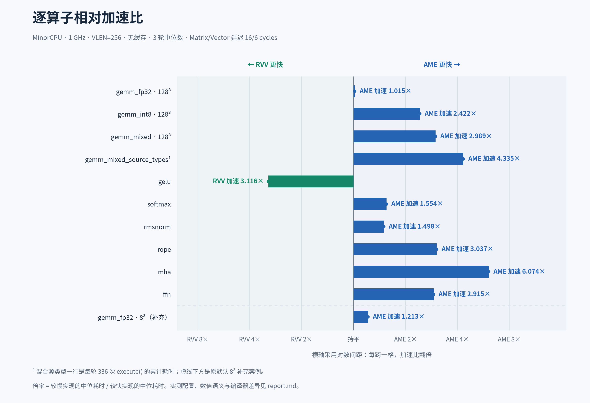
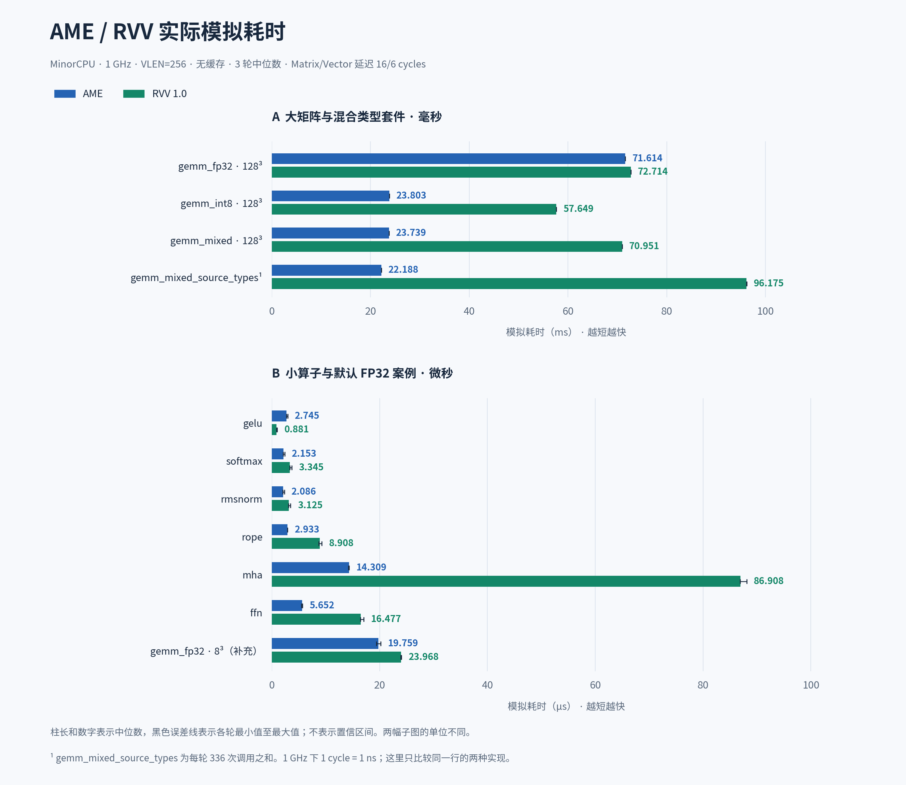

# AME 与 RVV 1.0 算子性能对比报告

报告生成时间：2026-11-06T01:41:18+08:00（Asia/Shanghai）。源代码基线：`9b5726d15920ce56bfd125027bb4dd7272a7d03d`；
各次构建的输入文件散列另存于 `result.json`。本报告由 [benchmark/report.py](benchmark/report.py)
读取实际模拟结果生成，没有使用估算时间代替实测。

## 1. 结论与性能对比

在下述固定配置下，10 个原算子中 RVV 快于 AME 的有 **1 个**，慢于 AME 的有 **9 个**。
`gelu`：RVV 加速 3.116×；`gemm_fp32`：AME 加速 1.015×；`mha`：AME 加速 6.074×。此外单独测量原 FP32 配置文件的 8×8 输入，避免把 128×128 数据与原默认小矩阵混为一谈。

**统一口径：S = AME 中位耗时 / RVV 中位耗时。** S > 1 表示 RVV 加速 S 倍；S < 1 表示
AME 相对 RVV 加速 1/S 倍，即 RVV 耗时是 AME 的 1/S 倍。耗时变化 = (RVV/AME − 1) × 100%。
下表使用 3 轮的中位数，单位是模拟 CPU 周期，不是宿主机运行秒数。
CPU 为 1 GHz，故 **1 cycle = 1 ns，时间 μs = cycles / 1000**。

### 1.1 直观对比图

**相对加速比：蓝色表示 AME 更快，绿色表示 RVV 更快；中心线表示持平。**
图中逐项标注“AME 加速 X×”或“RVV 加速 X×”，横轴采用对数间距，每跨一格倍率翻倍。
这与下表 S=AME/RVV 的原始比值口径不同：图中文字始终给出较快一方相对较慢一方的加速倍数。



**绝对耗时：同一行中柱子越短越快。** 大矩阵使用 ms，小算子使用 μs，分面避免小算子被数量级差异淹没。
柱子为中位数，误差线为最小值至最大值；两幅子图不可直接比较柱长。



可用于缩放或导出的矢量原图：[加速比 SVG](figures/ame_rvv_speedup.svg)、
[耗时 SVG](figures/ame_rvv_latency.svg)。图表直接读取同一份实测数据，不重新运行模拟器。

### 1.2 逐算子主表

| 算子 | AME cycles | RVV cycles | S=AME/RVV | RVV 耗时变化 | 结论 |
|---|---:|---:|---:|---:|---|
| `gemm_fp32` | 71,613,796 | 72,713,832 | 0.9849 | +1.54% | AME 加速 1.015× |
| `gemm_int8` | 23,802,586 | 57,648,783 | 0.4129 | +142.20% | AME 加速 2.422× |
| `gemm_mixed` | 23,738,860 | 70,950,914 | 0.3346 | +198.88% | AME 加速 2.989× |
| `gemm_mixed_source_types` | 22,188,153 | 96,174,942 | 0.2307 | +333.45% | AME 加速 4.335× |
| `gelu` | 2,745 | 881 | 3.1158 | -67.91% | RVV 加速 3.116× |
| `softmax` | 2,153 | 3,345 | 0.6436 | +55.36% | AME 加速 1.554× |
| `rmsnorm` | 2,086 | 3,125 | 0.6675 | +49.81% | AME 加速 1.498× |
| `rope` | 2,933 | 8,908 | 0.3293 | +203.72% | AME 加速 3.037× |
| `mha` | 14,309 | 86,908 | 0.1646 | +507.37% | AME 加速 6.074× |
| `ffn` | 5,652 | 16,477 | 0.3430 | +191.53% | AME 加速 2.915× |

### 1.3 原 FP32 默认配置补充

| 算子 | AME cycles | RVV cycles | S=AME/RVV | RVV 耗时变化 | 结论 |
|---|---:|---:|---:|---:|---|
| `gemm_fp32_config` | 19,759 | 23,968 | 0.8244 | +21.30% | AME 加速 1.213× |

`gemm_mixed_source_types` 一行是每轮 336 次 `execute()` 的 ROI 耗时之和，不是一次矩阵乘法。
各行工作量不同，不将它们相加或取平均倍率来代表整体模型吞吐率。

## 2. 对比范围与正确性

AME 输入来自 `example/`，RVV 输入来自 `example_rvv1.0/`，保留各自现有算子实现。
脚本只在构建目录生成插桩副本，不修改原算子源码。相同算子采用相同输入、输出格式和数学语义。

| 算子 | 实测工作负载 |
|---|---|
| `gemm_fp32` | M=N=K=128，FP32 |
| `gemm_int8` | 128³，I8×I8→I32，含 I32→I64→I32 |
| `gemm_mixed` | 128³，I8×I8→I32 |
| `gemm_mixed_source_types` | 14 组数值测试，每轮 336 次 execute |
| `gelu` | 4×4 FP32，原例 base-2 sigmoid 近似 |
| `softmax` | 4×4 FP32，逐行 base-2 Softmax |
| `rmsnorm` | 4×4 FP32，逐行，无 epsilon/gamma |
| `rope` | 4×4 FP32，角度 [0, 3] 弧度 |
| `mha` | 2 个 head，4×4 Q/K/V 与 attention |
| `ffn` | 4×4，两次 GEMM + GELU |
| `gemm_fp32_config` | M=N=K=8，原配置文件默认输入 |

GELU 沿用原示例的 `x / (1 + 2^(-2x))` 近似；Softmax 沿用 base-2 指数。
RVV 的指数辅助函数按原输入域构造整数指数值，不能把这里的结果外推为任意实数输入上的通用 GELU/Softmax 性能。
RoPE 的 RVV 实现以 FP64 的 14 项 Taylor 展开计算正余弦后转回 FP32，仅覆盖原例的角度域。

混合源类型目录原有 17 组，RVV 对应其中 **14 组数值测试**。AME 插桩副本也只运行这 14 组，
保留类型组合、转置/取负、舍入、饱和和异常标志等数值检查，排除最后 3 组 AME 专属的非法类型/寄存器跨度检查。
每轮有 336 次 `execute()`，两边数量一致。

本次共验证 **22 个目标二进制、66 轮工作负载、2076 段 ROI**：

- 每个目标程序的完整输出报告逐字节等于独立编译运行的 Host 标量参考报告。
  普通算子报告包含全输出 FNV-1a 哈希及采样元素原始位模式；混合类型报告逐项包含全部数值和状态标志。
- 同一程序各轮输出哈希一致；AME 与 RVV 的完整输出报告也逐字节一致。
- 所有 RVV ROI 都实际提交了向量指令，Matrix 类计数均为 0；所有 AME ROI 的 Matrix 类计数均大于 0。
- `report.py` 再次检查二进制/输出散列、Host 输出、ROI 完整性、逐轮统计和中位数后才生成此文档。

这证明本报告列出的输入通过验证；不等同于穷举验证任意输入。

## 3. 模拟器与编译环境

| 项目 | 本次配置 |
|---|---|
| 执行容器 | `ame-gem5-rvv:local`，Ubuntu 24.04.3 LTS |
| Python | 3.12.3 |
| Host 标量编译器 | cc (Ubuntu 13.3.0-6ubuntu2~24.04.1) 13.3.0 |
| gem5 | `25.1.1.1-dev`，仓库 `build/RISCV/gem5.opt` |
| CPU | 单核 `RiscvMinorCPU`，timing 模式，1 GHz |
| 运行方式 | 全系统裸机 ELF + RISC-V semihosting，无 guest OS |
| RVV | VLEN=256 bits，ELEN=64 bits |
| 向量非访存 FU | opLat=6 cycles，issueLat=1 cycle |
| AME Matrix FU | opLat=16 cycles，issueLat=16 cycles |
| AME tile | 原示例 4×4 square；INT8 K 步长 16 |
| 内存 | 128 MiB，`DDR3_1600_8x8`，`SystemXBar` |
| 缓存 | 无 I-cache/D-cache；CPU 指令/数据端口直接连接 SystemXBar |
| cache_line_size 参数 | 64 bytes（不代表配置了 cache） |
| AME 编译器 | clang version 21.0.0git |
| RVV 编译器 | Ubuntu clang version 18.1.3 (1ubuntu1) |
| 链接器 | Ubuntu LLD 18.1.3 (compatible with GNU linkers)，两边一致 |
| AME ISA 编译参数 | `-march=rv64gcv_xxiangshanztt -mabi=lp64d` |
| RVV ISA 编译参数 | `-march=rv64gcv -mabi=lp64d` |
| 共同优化参数 | `-O2 -ffp-contract=off -fno-vectorize -fno-slp-vectorize` |
| 共同裸机参数 | `-ffreestanding -fno-builtin -mcmodel=medany -nostdlib -static` |
| 启动和运行时 | 两边共用 `example/common/crt0.S`、`runtime.c`、`link.ld` |
| 重复测量 | 每个二进制在同一 guest 内运行 3 轮；每轮重置统计 |
| 仿真限制 | 每个程序最多 30,000,000,000,000 ticks，默认宿主超时 1800 秒 |

AME 工具链固定到 `OpenXiangShan/AME_llvm` 子模块提交 `22c930a6825636cfeb0c3db676d3cf8b57375cfa` 中的预编译归档。
安装脚本通过 GitHub Blob API 获取两个固定 blob，验证分片和完整包 SHA256 后解压。
完整包 SHA256：`b789a3addd548e3820d94704f21193f64a6ce8a0d8496bc9f075181a37cf9882`。
gem5 二进制 SHA256：`7d83c8774d5c8f4c95b4d9be92505081e5e556cc4b9779cf5e32da689658f0d3`。

**编译器版本不相同**：AME 需要仓库配套 Clang 21 扩展工具链，标准 RVV intrinsics 使用 Clang 18。
因此这里比较的是“当前实现 + 对应编译器 + 当前 gem5 模型”的实际执行结果，不是剥离编译器影响的纯 ISA 实验。
`-fno-vectorize/-fno-slp-vectorize` 不会禁止编译器在内存清零/复制等辅助代码中生成 RVV；
AME 路径中的此类向量指令计数在第 5 节单独列出。

## 4. 测量边界与统计方法

测量标记是 gem5 的 `m5_work_begin/end` 指令编码，并用 `fence rw,rw` 约束访存。
模拟器遇到 begin 后重置 CPU 统计，遇到 end 记录实际经过的 ticks 和已提交指令计数。
周期数按 `(end_tick − start_tick) / 1000` 计算，包含取指、访存和流水线等待，
不使用可能排除空闲阶段的 CPU 活跃周期计数代替总耗时。

普通算子在输入初始化完成后进入 ROI，输出描述、哈希、文本格式化和 semihost 文件输出位于 ROI 外。
ROI 包含真实算子调用、GEMM 分块/打包，以及 AME acquire、类型配置和 release；
RoPE 的 ROI 放在实际 tile 计算函数内。MHA/FFN 计量整条算子组合路径。

混合源类型套件逐次包围 `execute()`：包括 AME 输入打包、类型/状态设置、矩阵计算、结果复制，
或 RVV 软件解码、舍入/饱和处理及向量计算；输入场景构造、结果登记、报告输出和套件级 acquire/release 在外。
将每轮 336 段耗时求和后再对 3 轮取中位数。边界指令和 fence 的开销没有额外扣除，
该行与单个连续 ROI 的微内核不是同一测量粒度。

没有另外丢弃首轮作为预热。轮间重新准备输入并重置统计，但不重置 CPU、分支预测器或 DRAM 状态；
初始化虽然不计时，仍会影响进入 ROI 时的硬件状态。以下保留所有样本及范围，短算子的相对波动更明显。
这些重复是在同一仿真进程中取得的，不构成独立样本置信区间。
更换构建目录、二进制布局或启动参数也可能改变进入 ROI 前的状态；复测应保留完整命令与配置，不能要求每轮周期完全相同。

| 算子 | AME 各轮 cycles（执行顺序） | AME min–max | RVV 各轮 cycles（执行顺序） | RVV min–max |
|---|---|---|---|---|
| `gemm_fp32` | 71,617,947 / 71,613,796 / 71,613,788 | 71,613,788–71,617,947 | 72,714,663 / 72,713,832 / 72,713,730 | 72,713,730–72,714,663 |
| `gemm_int8` | 23,805,839 / 23,802,586 / 23,801,543 | 23,801,543–23,805,839 | 57,649,150 / 57,648,783 / 57,648,636 | 57,648,636–57,649,150 |
| `gemm_mixed` | 23,742,253 / 23,738,264 / 23,738,860 | 23,738,264–23,742,253 | 70,951,118 / 70,950,914 / 70,950,598 | 70,950,598–70,951,118 |
| `gemm_mixed_source_types` | 22,185,212 / 22,190,936 / 22,188,153 | 22,185,212–22,190,936 | 96,204,489 / 96,174,942 / 96,167,035 | 96,167,035–96,204,489 |
| `gelu` | 2,745 / 2,693 / 2,959 | 2,693–2,959 | 997 / 881 / 881 | 881–997 |
| `softmax` | 2,153 / 2,124 / 2,404 | 2,124–2,404 | 3,306 / 3,714 / 3,345 | 3,306–3,714 |
| `rmsnorm` | 2,086 / 2,061 / 2,328 | 2,061–2,328 | 3,125 / 3,491 / 3,111 | 3,111–3,491 |
| `rope` | 2,933 / 2,934 / 2,919 | 2,919–2,934 | 9,280 / 8,908 / 8,727 | 8,727–9,280 |
| `mha` | 14,196 / 14,357 / 14,309 | 14,196–14,357 | 88,100 / 86,908 / 86,883 | 86,883–88,100 |
| `ffn` | 5,521 / 5,672 / 5,652 | 5,521–5,672 | 17,061 / 16,463 / 16,477 | 16,463–17,061 |
| `gemm_fp32_config` | 20,213 / 19,393 / 19,759 | 19,393–20,213 | 24,056 / 23,968 / 23,887 | 23,887–24,056 |

## 5. 指令计数佐证

表中使用每轮计数的中位数。Matrix 类是 gem5 `Matrix + MatrixMov + MatrixOP` 分类之和，
**不包括所有 AME 设置/加载/存储指令**。总指令是 `commitStats0.numInsts`，
向量计数是 `numVecInsts`；微操作另存为 `ops`。这些分类计数不能直接等同为算术运算次数或内存字节数。

| 算子 | AME 总指令 | AME Matrix 类 | AME 辅助 RVV | RVV 总指令 | RVV 向量指令 |
|---|---:|---:|---:|---:|---:|
| `gemm_fp32` | 2,063,924 | 34,820 | 107,520 | 2,923,682 | 1,056,768 |
| `gemm_int8` | 1,836,628 | 12,294 | 9,216 | 2,139,288 | 1,071,104 |
| `gemm_mixed` | 1,834,578 | 10,244 | 9,216 | 2,118,802 | 1,054,720 |
| `gemm_mixed_source_types` | 941,884 | 3,024 | 0 | 4,963,504 | 346,944 |
| `gelu` | 29 | 14 | 0 | 57 | 24 |
| `softmax` | 24 | 12 | 0 | 223 | 90 |
| `rmsnorm` | 24 | 11 | 0 | 187 | 58 |
| `rope` | 30 | 15 | 0 | 555 | 418 |
| `mha` | 159 | 58 | 30 | 3,563 | 1,108 |
| `ffn` | 99 | 24 | 6 | 675 | 184 |
| `gemm_fp32_config` | 718 | 20 | 188 | 959 | 288 |

AME 路径可能含辅助 RVV，RVV 路径的 Matrix 类计数全部为 0。
统计支持对实现工作量的比较，但不足以单独证明某个瓶颈来自 DRAM 带宽、依赖链或功能单元。

## 6. 逐算子分析

1. **FP32 GEMM：AME 加速 1.015×。** 128³ 下两边接近；AME 的 tile 复制/打包也在计时内，
   RVV 沿输出列向量化并直接读取矩阵，保留逐项 FP32 乘法和加法。
   AME 的矩阵算术粒度更大，却还有大量标量/辅助向量指令及访存开销，不能仅按矩阵指令条数预测总耗时。
   原默认 8³ 的结论是 AME 加速 1.213×，说明尺寸变化会改变相对开销。
2. **INT8 GEMM：AME 加速 2.422×。** AME 每个 K 步长为 16，将 4 个 4×4 square 打包；
   RVV 按 K 循环加载字节、符号扩展到 I32 并做向量 MAC，提交的向量运算数量更高。
   两边均保留原例额外的 I32→I64→I32 转换，所以此行不只是裸 INT8 GEMM。
3. **Mixed GEMM：AME 加速 2.989×。** 此目录实际是 I8×I8→I32，去掉上面的往返转换。
   当前 RVV `gemm_int8` 反而比 `gemm_mixed` 用时短，不能解释为“加转换会加速”。
   两者共用 RVV GEMM 内核但二进制/数据布局不同；无缓存取指、DRAM 状态和布局可能影响结果，
   这是待进一步拆分验证的解释，不是已证实的单一瓶颈。
4. **Mixed source types：AME 加速 4.335×。** AME 硬件路径支持混合输入格式，
   RVV 还需软件执行 INT4/FP8 等格式解码、状态/舍入处理。整行包含 336 次调用的这些成本。
   它更适合评价当前混合类型实现与测试集合，不应当成一个固定尺寸 GEMM 的吞吐指标。
5. **GELU：RVV 加速 3.116×。** 原输入允许 RVV 通过整数指数位构造实现 base-2 指数，
   16 个元素在少量向量批次内完成。后续对照实验表明，原配置下主要差距来自 AME 串行化与无缓存取指的相互影响，省去常量开方只带来较小收益；具体数据见后面的 GELU 补充实验。
   本结论限于当前近似函数、输入域和模拟器配置。
6. **Softmax：AME 加速 1.554×。** AME 有矩阵逐行归约和广播操作；RVV 显式循环各行，
   分别求最大值、指数、按序求和及归一化。保持原求和顺序也限制了可采用的重排。
7. **RMSNorm：AME 加速 1.498×。** 与 Softmax 类似，RVV 的逐行有序归约、标量倒数和
   多次向量设置增加了小尺寸开销；本例没有常见生产实现中的 epsilon 或 gamma 乘法。
8. **RoPE：AME 加速 3.037×。** AME 用原生 sin/cos 矩阵指令，受当前 Matrix FU 延迟模型约束；
   RVV 则显式计算 14 项 FP64 多项式再转换为 FP32。该结果同时体现数学实现与功能单元建模差异，
   不代表真实硬件的 sin/cos 一定能以同样成本完成。
9. **MHA：AME 加速 6.074×。** 原例为两个 head 的小矩阵组合，包含 Q/K/V 投影、QKᵀ、
   Softmax 和 context。AME 按矩阵粒度完成，RVV 多次进入逐行/逐 K 循环，提交指令更多。
   这里没有测试生产 Transformer 的大 sequence、batch 或 head dimension。
10. **FFN：AME 加速 2.915×。** 两次小 GEMM 和 GELU 串联；GELU 单项的 RVV 优势未抵消
    整体矩阵乘法和调用开销。单独优化一个子算子不等于整条计算路径同比加速。

### 6.1 结论边界与后续优化方向

无缓存配置使取指和数据访问直接进入内存系统；两套编译器、布局、输入规模和功能单元延迟都会影响倍率。
RVV 当前实现以正确复现原例为目标，尚未进行多行寄存器分块、B 向量复用等 GEMM 调优。
可先尝试这些优化并继续逐字节校验；若改为融合乘加或重排浮点归约，需单独定义并验证数值误差契约。

增加缓存、更换 VLEN、改变 Matrix/Vector FU 延迟、扩大 MHA/FFN 尺寸都值得另做实验。
本报告只包含上述一套配置的实测，未对这些未测配置作性能承诺，也未将模拟周期解释为真实芯片结果。

### 6.2 GELU 的主要差距来源：补充对照实验

后续针对“RVV 更快是否主要因为省掉 sqrt(4)”进行了实测。
**证据指向当前 AME 模型的频繁串行化与无指令缓存取指之间的相互影响。**
只删除常量开方的影响较小；在无缓存配置中，Matrix 功能单元的标称延迟也没有决定这里的总耗时。
此前仅依据代码强调常量简化、指数实现和功能单元延迟，不足以说明主要因素，以下对照提供进一步依据。

第一组保留主报告的原始总线/SnoopFilter 配置，各实验使用同一路径启动保存的 ELF，
保持代码地址、输入准备和测量边界。删除开方的实验只修改三个 32 位机器字：把常量 4 改为 2、
把 `msqrt.ew` 替换为同长度 NOP、让后续乘法读取全 2 矩阵。
未删除额外缓冲区和类型设置，避免把多项优化合并为“少一次开方”。

| 实验 | 三轮 cycles | 中位 cycles | 强制重定向次数/轮 |
|---|---|---:|---:|
| AME 原实现，无 I-cache | 2,745 / 2,693 / 2,958 | 2,745 | 23 |
| AME 直接使用 2，开方替换为 NOP | 2,643 / 2,591 / 2,871 | 2,643 | 22 |
| AME Matrix 延迟/发射间隔改为 6 | 2,745 / 2,693 / 2,958 | 2,745 | 23 |
| AME Matrix 延迟/发射间隔改为 1 | 2,745 / 2,693 / 2,958 | 2,745 | 23 |
| RVV 原实现，无 I-cache | 983 / 831 / 881 | 881 | 0 |

AME 从 2745 降到 2643 cycles，仅减少 102 cycles（3.72%）。
这个差值包含少一次串行化的影响，不能全部计为平方根算术延迟。
Matrix 的 opLat/issueLat 从 16 降到 6 或 1，三轮耗时均未改变，说明在这一配置下它们的开销被其他等待遮蔽。

ROI 的 Branch/Fetch 日志确认，AME 每轮发生 **23 次强制取指重定向**，RVV 为 **0 次**。
ROI 内 CPU 取指请求数的中位数分别为 **52 次与 17 次**，
尽管已提交指令数分别只有 29 条与 57 条。
这些重定向来自 `SerializeAfter` 等标记，不应当全部解释为分支预测失败。
AME 的类型配置、算术和访存操作具有串行化标记；MinorCPU 在提交后改变取指流，重新取得后续指令。
无 I-cache 时，频繁重新取指需要经过总线和 DRAM，短算子因此积累了大量非算术等待。
这是当前 gem5 的实现方式，不能视为真实 AME 硬件必然具有的开销。

第二组固定相同 ELF 和数据访存路径，仅对照是否增加 **32 KiB、2 路、tag/data/response 延迟均为 1 cycle 的 I-cache**。
本仓库的 I-cache 与直连 CPU 数据端口组合会触发 SnoopFilter 断言，因此第二组的所有实验都统一关闭可选 SnoopFilter，
保留一致性广播，D-cache 仍然关闭。此组应使用自己的无缓存基线，不能直接与第一组相减。

| 实验 | 三轮 cycles | 中位 cycles | 强制重定向次数/轮 |
|---|---|---:|---:|
| AME 原实现，无 I-cache | 2,693 / 2,981 / 2,678 | 2,693 | 23 |
| AME 直接使用 2，开方替换为 NOP | 2,593 / 2,867 / 2,591 | 2,593 | 22 |
| AME Matrix 延迟/发射间隔改为 6 | 2,693 / 2,981 / 2,678 | 2,693 | 23 |
| AME Matrix 延迟/发射间隔改为 1 | 2,693 / 2,981 / 2,678 | 2,693 | 23 |
| RVV 原实现，无 I-cache | 964 / 815 / 1,124 | 964 | 0 |
| AME 原实现，增加 I-cache | 820 / 662 / 676 | 676 | 23 |
| RVV 原实现，增加 I-cache | 604 / 265 / 262 | 265 | 0 |
| AME 有 I-cache，Matrix 延迟/发射间隔改为 6 | 630 / 522 / 536 | 536 | 23 |

在第二组内部，增加指令缓存后，AME/RVV 的绝对周期差从 **1729 缩小到 411 cycles**，
减少约 **76.2%**，而 AME 的 23 次串行化重定向仍然存在。
有 I-cache 后再将 Matrix 延迟由 16 改为 6，AME 从 676 降到
536 cycles；此时功能单元延迟的影响才清楚显现。

这些实验支持“串行化叠加取指等待是当前配置中的主要差距来源”，不构成各项开销可独立相加的精确分解。
缓存还会改变总线竞争和进入 ROI 时的状态；常量设置、指数实现和编译器差异仍然存在。
主报告原有性能表和图保持原始配置的数据，未被本节的诊断配置覆盖。

共新增 13 个对照配置、39 轮，全部输出报告与原 Host golden 一致。
原始配置结果：[results_original_filter.json](build/performance/gelu_diagnosis/results_original_filter.json)；
缓存对照：[results.json](build/performance/gelu_diagnosis/results.json)；每项的 `m5out/trace.txt` 保留 ROI 内 Branch/Fetch 跟踪。
诊断脚本：[diagnose_gelu.py](benchmark/diagnose_gelu.py)。复现命令如下，使用已有完整性能测试产物：

```bash
docker run --rm --user "$(id -u):$(id -g)" \
  -v "$PWD:/work" -w /work ame-gem5-rvv:local \
  python3 example_rvv1.0/benchmark/diagnose_gelu.py --original-filter-controls

docker run --rm --user "$(id -u):$(id -g)" \
  -v "$PWD:/work" -w /work ame-gem5-rvv:local \
  python3 example_rvv1.0/benchmark/diagnose_gelu.py
```

随后重新运行 `report.py`，会自动纳入与主报告 ELF 匹配的完整诊断结果。

## 7. 脚本与复现步骤

| 文件 | 用途 |
|---|---|
| [setup_toolchain.py](benchmark/setup_toolchain.py) | 下载并校验固定 AME Clang 归档；支持离线归档 |
| [run.py](benchmark/run.py) | 生成插桩副本、编译 Host/目标、并行仿真、正确性/ISA 检查、汇总 JSON |
| [perf_config.py](benchmark/perf_config.py) | AME/RVV 共用系统配置与 ROI 事件采集 |
| [roi.h](benchmark/roi.h) | 工作区间标记及访存 fence |
| [report.py](benchmark/report.py) | 复核完整结果，生成本文、CSV 与对比图 |
| [plot.py](benchmark/plot.py) | 使用 Matplotlib 绘制加速比/耗时图，输出 PNG 和 SVG |
| [Dockerfile](Dockerfile) | Ubuntu 24.04、Clang/LLD 18、gem5 构建依赖与中文绘图环境 |

以下命令在仓库根目录执行。需要 Docker；首次构建镜像/下载工具链需要网络。
Dockerfile 使用发行版包仓库，重建时补丁版本可能变化；本文记录的是实际测量版本。
宿主机速度只影响仿真完成时间，不参与性能倍率。`--jobs` 是宿主侧并行仿真数，不是 guest 核数。

### 7.1 首次准备环境

```bash
cd /data/mingwei/project/xiangshanwmw/AME_gem5

docker build -t ame-gem5-rvv:local \
  -f example_rvv1.0/Dockerfile example_rvv1.0

docker run --rm --user "$(id -u):$(id -g)" \
  -v "$PWD:/work" -w /work ame-gem5-rvv:local \
  scons build/RISCV/gem5.opt -j16 --ignore-style

docker run --rm --user "$(id -u):$(id -g)" \
  -v "$PWD:/work" -w /work ame-gem5-rvv:local \
  python3 example_rvv1.0/benchmark/setup_toolchain.py --direct
```

已有 gem5 和工具链时可跳过相应编译/安装步骤。新增绘图依赖为 `python3-matplotlib` 和 `fonts-noto-cjk`，
旧版镜像需要先重新执行上面的 `docker build`，之后从 7.2 开始。
内存不足时将 SCons 的 `-j16` 调低。`--direct` 忽略代理环境变量；需要代理时移除此选项并配置容器网络。
离线时将校验一致的完整归档放到仓库内，再用 `--archive /work/路径/ame_toolchain.tar.gz`。
安装器拒绝覆盖已有非空且未标记为同一归档的工具链目录；可以 `--dest` 安装到新目录，
再给 `run.py` 指定相应 `--ame-clang` 与 `--objdump`。

### 7.2 重新测量全部算子并生成报告

```bash
docker run --rm --user "$(id -u):$(id -g)" \
  -v "$PWD:/work" -w /work ame-gem5-rvv:local \
  python3 example_rvv1.0/benchmark/run.py \
    --jobs 4 --repeats 3 --vlen 256 \
    --matrix-op-lat 16 --vector-op-lat 6 \
    --output example_rvv1.0/build/performance/default

docker run --rm --user "$(id -u):$(id -g)" \
  -v "$PWD:/work" -w /work ame-gem5-rvv:local \
  python3 example_rvv1.0/benchmark/report.py \
    --input example_rvv1.0/build/performance/default \
    --output example_rvv1.0/report.md
```

默认运行 10 个算子和额外的 8³ FP32 案例，每种 AME/RVV 各测 3 轮。
正常结束打印 `[PASS] 22 measured binaries`，随后报告脚本打印生成路径。
`report.py` 同时在报告旁的 `figures/` 中生成两张图的 PNG 和 SVG，无须额外执行绘图命令。
如果只更新图表，可运行 `python3 example_rvv1.0/benchmark/plot.py`；默认读取已有结果，不再仿真。
直接在宿主执行绘图需 Python 3.12+、Matplotlib、NumPy 和中文字体（推荐 Noto Sans CJK）。
`--resume` 可复用指纹匹配且产物校验通过的成功结果；需要新一轮实测时不要传它。
默认目录中的同名产物会更新；要保留旧结果，请使用新的 `--output` 目录。

### 7.3 单独复测与参数设置

```bash
# 两个算子的快速对比；仍会校验 Host 与 AME/RVV 输出。
docker run --rm --user "$(id -u):$(id -g)" \
  -v "$PWD:/work" -w /work ame-gem5-rvv:local \
  python3 example_rvv1.0/benchmark/run.py \
    --cases gelu rope --repeats 3 --jobs 2 \
    --output example_rvv1.0/build/performance/quick

# 查看全部可配置项。
docker run --rm --user "$(id -u):$(id -g)" \
  -v "$PWD:/work" -w /work ame-gem5-rvv:local \
  python3 example_rvv1.0/benchmark/run.py --help
```

可用 `--variants ame` 或 `--variants rvv` 单独运行一侧；`--vlen` 支持 128/256/512/1024，
`--matrix-op-lat`、`--vector-op-lat` 调整模型延迟。改变配置应使用新目录并同时测量两侧。
完整 `report.py` 要求 11 对工作负载齐全且配置一致；局部运行请直接查看其 `results.json`，
不能以不完整数据覆盖全套报告。若分开运行两侧，最后以默认双侧 `run.py --resume` 合并并交叉校验。

不使用 Docker 时需准备兼容 gem5 二进制的 Linux 用户态、Python 3.12+、Clang/LLD 18、Host C 编译器和
已安装的 AME 工具链；可通过 `--gem5 --ame-clang --rvv-clang --objdump --linker --host-cc` 指定路径。
本次宿主旧系统不直接运行 Ubuntu 24.04 内构建的 gem5，统一在容器中执行。

## 8. 原始产物与审计入口

当前数据目录：[build/performance/default](build/performance/default/)。构建产物在 Git 忽略目录内；
重新克隆时需要运行脚本生成，本文中的样本、倍率和输出散列保留了此次结果。

- [`results.json`](build/performance/default/results.json)：22 个结果的输入散列、编译器、样本、中位数和输出散列。
- [`comparison.csv`](build/performance/default/comparison.csv)：与性能主表一致的机器可读数据（含默认 8³ 补充案例）。
- [`environment.json`](build/performance/default/environment.json)：运行环境版本。
- `<case>/<ame|rvv>/roi.json`：每段 begin/end ticks、指令分类和工作轮次。
- 同目录 `host.txt` / `guest.txt`：逐字节核对的参考/目标完整输出。
- 同目录 `build-target.log`、`build-host.log`、`simulation.log`、`disassembly.txt`：完整命令和运行证据。
- 同目录 `m5out/config.json` / `config.ini`：实际实例化的 gem5 配置。

以下为完整输出报告的 SHA256；同一行 AME、RVV 及各自 Host 均相同。

| 算子 | AME/RVV/Host 一致的输出 SHA256 |
|---|---|
| `gemm_fp32` | `d6efdca747cf11ed479cccf559976f99eb0e8b797bd571ab011f5967ab05090c` |
| `gemm_int8` | `0547456950e1666a9430c026e6837291558aabea044c7b9886aede9a42b6ff84` |
| `gemm_mixed` | `317338533e8dd24ff0704ab3b9175a0a77bb95abd71a142d3f6942b10dcfc35a` |
| `gemm_mixed_source_types` | `bdd6a18dce84c217d6aaa10bcf460044bcf0a07b9c4e5d4461c8b91ce1054746` |
| `gelu` | `fc12c3f4bb54eee3fd58425bb91312e34fa9a2fd1d9813f6727470194831fc93` |
| `softmax` | `31ff689d00aa1165661e66ac5085679e8390bfe969ac0679886289acf381ee26` |
| `rmsnorm` | `cf4265e9e31053a03940621b1aea57688a99d876983d192bd68651d562ae6865` |
| `rope` | `8655de9507389bbedab6a7763364bd819bd42d37da000d51be27465fc5954f1c` |
| `mha` | `b19aec740af2f5cb6f8b87a2df5992abb9efa8caffd9410488cc6d432cb759d8` |
| `ffn` | `77b7fcfb7217aed2cde750946ac27ba68b3b0d992db4373d34ca9ba736d46448` |
| `gemm_fp32_config` | `2bde55697d94102b3ca5ca01aed18d153f270cb27c82fb3d6b3f77aa7342f1cc` |
